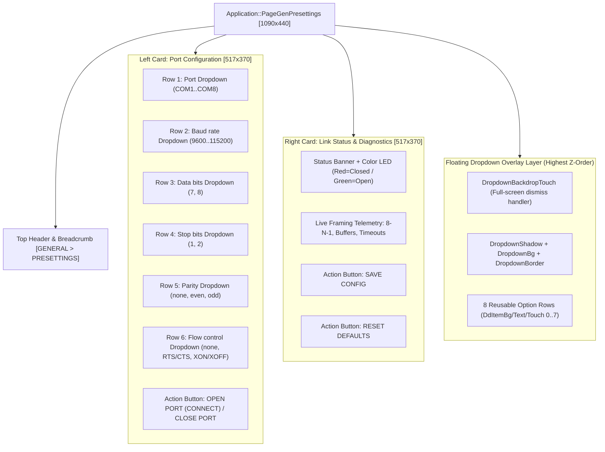

# Embedded Wizard Studio (EWS) - Presettings Screen Design Guide
## Designing the Serial Communication "Port Configuration" Screen with Expandable Dropdown Menus

---

### Welcome!
In industrial automation, medical devices, and laboratory instrumentation, establishing a reliable serial communication link (RS-232, RS-422, or RS-485 Modbus) is one of the most critical startup tasks.

This guide details the complete design, architecture, and step-by-step implementation of the **General &rarr; Presettings** screen in Embedded Wizard Studio (`SerialComEWS`). It translates a traditional **"Port configuration"** dialog (`Port`, `Baud rate`, `Data bits`, `Stop bits`, `Parity`, `Flow control`) into an **industrial dark-themed HMI interface with true expandable floating dropdown menus**.

---

## Table of Contents
1. [Screen Architecture & Visual Layout](#1-screen-architecture--visual-layout)
2. [Serial Communication Fundamentals (Friendly Engineering Note)](#2-serial-communication-fundamentals-friendly-engineering-note)
3. [How Proper Expandable Dropdowns Work in Embedded Wizard (Z-Order Pattern)](#3-how-proper-expandable-dropdowns-work-in-embedded-wizard-z-order-pattern)
4. [Step-by-Step IDE Guide: Constructing `PageGenPresettings`](#4-step-by-step-ide-guide-constructing-pagegenpresettings)
5. [State Management & Chora Dropdown Logic](#5-state-management--chora-dropdown-logic)
6. [Hardware Bridge: How This Connects to Real C/C++ Serial Drivers](#6-hardware-bridge-how-this-connects-to-real-cc-serial-drivers)
7. [Testing in the Prototyper (F5)](#7-testing-in-the-prototyper-f5)

---

## 1. Screen Architecture & Visual Layout

The screen is built inside the component **`Application::PageGenPresettings`** (derived from `Core::Group`), occupying the active content canvas of `<0, 0, 1090, 440>`.



### Screen Budget Breakdown (`1090 x 440`):
* **Title Bar (`y = 0 to 46`)**: Title label `"General - Serial Port Configuration & Presettings"` and breadcrumb tag.
* **Left Card (`x: 18 to 535, y: 58 to 426`)**: The 6 serial configuration dropdown fields and the `OPEN PORT (CONNECT)` toggle button.
* **Right Card (`x: 555 to 1072, y: 58 to 426`)**: Real-time link diagnostics, status LED, dynamic framing summary (`8-N-1`), and `SAVE CONFIG` / `RESET DEFAULTS` buttons.
* **Floating Dropdown Layer (Dynamic Z-Order Overlay)**: Appears directly beneath the tapped field (or upward for `Flow control` so it never clips off the bottom edge).

---

## 2. Serial Communication Fundamentals (Friendly Engineering Note)

> **Friendly Note - Why are these specific 6 parameters needed to establish communication?**
> Asynchronous serial communication (UART) does not transmit a shared clock wire between devices. Instead, both the transmitter and receiver must agree **in advance** on the exact timing and framing rules. If even one setting is mismatched, the incoming bits cannot be sampled, resulting in framing errors or garbled data.

| Parameter | Default | Dropdown Options | Significance & Hardware Impact |
| :--- | :--- | :--- | :--- |
| **Port** | `COM3` | `COM1` .. `COM8` | Identifies the physical transceiver hardware (Windows COM3, Linux `/dev/ttyUSB0`, or MCU `USART1`..`USART8`). |
| **Baud rate** | `57600` | `9600`, `19200`, `38400`, `57600`, `115200` | Transmission speed in bits per second. Both sides' Baud Rate Generators (BRG) must match within &plusmn;2% tolerance. |
| **Data bits** | `8` | `7`, `8` | Payload bits per character frame. Standard binary protocols (Modbus RTU) require **8 data bits**; legacy ASCII uses **7**. |
| **Stop bits** | `1` | `1`, `2` | Idle-high stop marker at the end of each byte. 1 stop bit is standard; 2 stop bits provide extra margin on noisy lines. |
| **Parity** | `none` | `none`, `even`, `odd` | Error-checking bit appended to each frame. `none` = 8-N-1; `even`/`odd` detects single-bit line corruption. |
| **Flow control** | `none` | `none`, `RTS/CTS`, `XON/XOFF` | Prevents RX buffer overruns. `RTS/CTS` uses dedicated hardware handshake lines; `XON/XOFF` uses software flow characters (`0x11`/`0x13`). |

---

## 3. How Proper Expandable Dropdowns Work in Embedded Wizard (Z-Order Pattern)

### The Secret Behind Floating Menus: Z-Order!
> **Friendly Note - How does a dropdown float ON TOP of buttons underneath it?**
> In Embedded Wizard (Mosaic), child views are drawn—and receive touch events—in the **exact order they appear in the component**:
> * Objects listed **earlier** are drawn at the **bottom** (background).
> * Objects listed **later** are drawn **on top** (foreground) and receive touch events **first**!

By placing a single shared **Floating Dropdown Overlay Layer** at the very end of `PageGenPresettings`, one lightweight popup serves **all 6 dropdown fields** cleanly:

```
  [ Highest Z-Order ]  DdItemTouch0..7 + DdItemBg0..7 + DdItemText0..7   <-- Catches taps on dropdown options!
         |             DropdownBorder + DropdownBg + DropdownShadow       <-- Floating menu box + shadow
         |             DropdownBackdropTouch (<0,0,1090,440>)             <-- Catches taps outside menu to close it!
         |             Left & Right Cards, 6 Dropdown Headers, Buttons    <-- Main screen UI
  [ Lowest Z-Order ]   PageCardBg                                         <-- Screen background
```

### Why This Design Works So Well:
1. **Focus Highlighting**: When you tap `Port`, its border turns bright sky blue (`#38BDF8FF`) and its arrow flips from `"v"` to `"^"`.
2. **Active Selection Highlight**: Inside the open dropdown list, the currently selected value (e.g., `COM3`) is highlighted with a solid blue bar (`#0284C7FF`) and bright white text.
3. **Click-Outside-to-Dismiss**: When a dropdown is open, `DropdownBackdropTouch.Enabled` becomes `true`. Tapping anywhere outside the dropdown menu (or tapping the open header again) hits the backdrop handler (`onCloseDropdown`) and smoothly closes the menu without accidentally clicking buttons underneath!
4. **Smart Upward Opening**: Because `Flow control` sits near the bottom of the `440px` canvas (`y = 328..362`), opening downward would clip off-screen. Instead, our logic automatically opens `Flow control` **upward** (`y = 222..326`) right above its box!
5. **Lightweight & Free-Edition Friendly**: Reusing 8 option slots (`DdItemBg0..7`, `DdItemText0..7`, `DdItemTouch0..7`) across all 6 dropdowns keeps total object count minimal—unlike duplicating 6 separate heavy `Combo Box` templates.

> **Alternative Note**: Embedded Wizard also includes a built-in **`Combo Box`** template in **Gallery &rarr; Component Templates &rarr; Combo Box** if you ever need a scrolling list with 20+ items. For 2–8 fixed serial options, the custom floating overlay pattern above is faster, cleaner, and easier to style.

---

## 4. Step-by-Step IDE Guide: Constructing `PageGenPresettings`

Follow these instructions to build or customize this screen directly in Embedded Wizard Studio:

### Step 4.1: Open the Component Class
1. In the **Browser** window (top-left tree), expand unit **`Application`**.
2. Double-click **`PageGenPresettings`** to open its `<0, 0, 1090, 440>` canvas.

### Step 4.2: Build the Left Panel ("PORT CONFIGURATION")
1. Add the card container:
   * `LeftPanelBg` (`Views::Rectangle`): `<18, 58, 535, 426>`, Color `#1B2436FF`, Radius `6`.
   * `LeftPanelBorder` (`Views::Border`): `<18, 58, 535, 426>`, Color `#2C3A52FF`, Width `1`.
   * `LeftPanelHeader` (`Views::Rectangle`): `<18, 58, 535, 94>`, Color `#212C42FF`.
   * `LeftPanelTitle` (`Views::Text`): `"PORT CONFIGURATION"`, Color `#38BDF8FF`.
   * `LeftPanelSubtitle` (`Views::Text`): `"Tap any dropdown field to open options list:"`, Color `#94A3B8FF`.

### Step 4.3: Build the 6 Dropdown Header Boxes
Each row is `34px` tall with `42px` vertical spacing:

| Row | Label | Bounds (`ComboBg` & `Touch`) | Value Text Brick | Border Brick | Arrow Brick | Touch `OnPress` Slot |
| :--- | :--- | :--- | :--- | :--- | :--- | :--- |
| 1 | `Port` | `<180, 118, 515, 152>` | `TextPort` (`"COM3"`) | `ComboPortBorder` | `ArrowPort` (`"v"`) | `onSelectPort` |
| 2 | `Baud rate` | `<180, 160, 515, 194>` | `TextBaud` (`"57600"`) | `ComboBaudBorder` | `ArrowBaud` (`"v"`) | `onSelectBaud` |
| 3 | `Data bits` | `<180, 202, 515, 236>` | `TextDataBits` (`"8"`) | `ComboDataBorder` | `ArrowData` (`"v"`) | `onSelectData` |
| 4 | `Stop bits` | `<180, 244, 515, 278>` | `TextStopBits` (`"1"`) | `ComboStopBorder` | `ArrowStop` (`"v"`) | `onSelectStop` |
| 5 | `Parity` | `<180, 286, 515, 320>` | `TextParity` (`"none"`) | `ComboParityBorder` | `ArrowParity` (`"v"`) | `onSelectParity` |
| 6 | `Flow control` | `<180, 328, 515, 362>` | `TextFlowControl` (`"none"`) | `ComboFlowBorder` | `ArrowFlow` (`"v"`) | `onSelectFlow` |

Below Row 6 (`y: 374..414`), add the primary **`OPEN PORT (CONNECT)`** button (`BtnConnectBg`, `TextConnectBtn`, `TouchConnect` &rarr; `onToggleConnect`).

### Step 4.4: Build the Right Panel ("COMMUNICATION LINK & DIAGNOSTICS")
1. Add the card container (`RightPanelBg`, `RightPanelBorder`, `RightPanelHeader`, `RightPanelTitle`).
2. Add the **Status Banner** (`<575, 106, 1052, 148>`):
   * `LedStatus` (`Views::Rectangle`, `Radius = 8` for a circular LED): `#EF4444FF` (Red) when closed, `#10B981FF` (Green) when open.
   * `TextPortStatus` (`Views::Text`): `"STATUS: CLOSED (Offline)"`.
3. Add the **Summary Telemetry Box** (`<575, 158, 1052, 362>`):
   * `TextConfigSummary` (`Views::Text`, `WrapText = true`): Displays live calculated serial parameters (`8-N-1`, baud rate, flow control, timeouts, and save confirmation).
4. Add bottom action buttons (`y: 374..414`):
   * `SAVE CONFIG` (`TouchSave` &rarr; `onSaveConfig`).
   * `RESET DEFAULTS` (`TouchReset` &rarr; `onResetDefault`).

### Step 4.5: Add the Floating Dropdown Overlay Layer (LAST in Z-Order!)
> **Important EWS IDE Tip**: Make sure these bricks are added **after** (or placed in front of) the left/right panel bricks using **Arrange &rarr; Bring to Front** in the Composer so they always float on top!

1. **`DropdownBackdropTouch`** (`Core::SimpleTouchHandler`):
   * Corners covering `<0, 0, 1090, 440>`.
   * `Enabled`: `false` *(Remember: `SimpleTouchHandler` uses `Enabled`, never `Visible`!)*.
   * `OnPress`: `onCloseDropdown`.
2. **`DropdownShadow`** (`Views::Rectangle`): Color `#00000088`, `Radius = 6`, `Visible = false`.
3. **`DropdownBg`** (`Views::Rectangle`): Color `#0F172AFF`, `Radius = 6`, `Visible = false`.
4. **`DropdownBorder`** (`Views::Border`): Color `#38BDF8FF`, `Width = 1`, `Radius = 6`, `Visible = false`.
5. **8 Reusable Option Rows (`0` to `7`)**:
   * For each `i` from `0` to `7`:
     - `DdItemBg{i}` (`Views::Rectangle`, `Radius = 4`, `Visible = false`)
     - `DdItemText{i}` (`Views::Text`, `Font = FontBody`, `Visible = false`)
     - `DdItemTouch{i}` (`Core::SimpleTouchHandler`, `Enabled = false`, `OnPress = onPickItem{i}`)

---

## 5. State Management & Chora Dropdown Logic

### 5.1 State Variables
Add these `var` bricks from Gallery &rarr; **Chora**:
```chora
var int32 SelectedPortIndex   = 2;     // 0=COM1 .. 2=COM3 .. 7=COM8
var int32 SelectedBaudIndex   = 3;     // 0=9600 .. 3=57600, 4=115200
var int32 SelectedDataIndex   = 1;     // 0=7, 1=8
var int32 SelectedStopIndex   = 0;     // 0=1, 1=2
var int32 SelectedParityIndex = 0;     // 0=none, 1=even, 2=odd
var int32 SelectedFlowIndex   = 0;     // 0=none, 1=RTS/CTS, 2=XON/XOFF
var bool  IsPortOpen          = false;
var int32 OpenDropdown        = 0;     // 0=Closed, 1=Port, 2=Baud, 3=Data, 4=Stop, 5=Parity, 6=Flow
var bool  JustSaved           = false;
```

### 5.2 Helper Method: `ConfigDropdownItem(...)`
Positions, styles, and enables a single option row (`0..7`) inside the floating popup:
```chora
method void ConfigDropdownItem( arg int32 aIndex, arg bool aVisible, arg int32 aTop, arg string aLabel, arg bool aSelected )
{
  var Views::Rectangle bg = null;
  var Views::Text txt = null;
  var Core::SimpleTouchHandler touch = null;

  if ( aIndex == 0 ) { bg = DdItemBg0; txt = DdItemText0; touch = DdItemTouch0; }
  if ( aIndex == 1 ) { bg = DdItemBg1; txt = DdItemText1; touch = DdItemTouch1; }
  if ( aIndex == 2 ) { bg = DdItemBg2; txt = DdItemText2; touch = DdItemTouch2; }
  if ( aIndex == 3 ) { bg = DdItemBg3; txt = DdItemText3; touch = DdItemTouch3; }
  if ( aIndex == 4 ) { bg = DdItemBg4; txt = DdItemText4; touch = DdItemTouch4; }
  if ( aIndex == 5 ) { bg = DdItemBg5; txt = DdItemText5; touch = DdItemTouch5; }
  if ( aIndex == 6 ) { bg = DdItemBg6; txt = DdItemText6; touch = DdItemTouch6; }
  if ( aIndex == 7 ) { bg = DdItemBg7; txt = DdItemText7; touch = DdItemTouch7; }

  if ( bg == null )
    return;

  bg.Visible    = aVisible;
  txt.Visible   = aVisible;
  touch.Enabled = aVisible;

  if ( aVisible )
  {
    var int32 y1 = aTop;
    var int32 y2 = aTop + 32;

    bg.Bounds    = rect( 184, y1, 511, y2 );
    bg.Color     = aSelected ? #0284C7FF : #0F172AFF;
    txt.Bounds   = rect( 196, y1, 500, y2 );
    txt.String   = aLabel;
    txt.Color    = aSelected ? #FFFFFFFF : #CBD5E1FF;
    touch.Point4 = point( 184, y1 );
    touch.Point3 = point( 511, y1 );
    touch.Point2 = point( 511, y2 );
    touch.Point1 = point( 184, y2 );
  }
}
```

### 5.3 Popup Positioning Method: `UpdateDropdown()`
Resizes and populates the floating list based on `OpenDropdown`:
```chora
method void UpdateDropdown()
{
  // Hide all 8 item slots first
  var int32 i = 0;
  while ( i < 8 )
  {
    ConfigDropdownItem( i, false, 0, "", false );
    i = i + 1;
  }

  var bool isOpen = ( OpenDropdown > 0 );
  DropdownBackdropTouch.Enabled = isOpen;
  DropdownShadow.Visible        = isOpen;
  DropdownBg.Visible            = isOpen;
  DropdownBorder.Visible        = isOpen;

  if ( !isOpen )
    return;

  var int32 menuTop    = 154;
  var int32 menuBottom = 418;

  // Example: Baud Rate (5 items, opens downward under Row 2)
  if ( OpenDropdown == 2 )
  {
    menuTop    = 196;
    menuBottom = 196 + ( 5 * 32 ) + 8;
    ConfigDropdownItem( 0, true, menuTop + 4 + ( 0 * 32 ), "9600",   SelectedBaudIndex == 0 );
    ConfigDropdownItem( 1, true, menuTop + 4 + ( 1 * 32 ), "19200",  SelectedBaudIndex == 1 );
    ConfigDropdownItem( 2, true, menuTop + 4 + ( 2 * 32 ), "38400",  SelectedBaudIndex == 2 );
    ConfigDropdownItem( 3, true, menuTop + 4 + ( 3 * 32 ), "57600",  SelectedBaudIndex == 3 );
    ConfigDropdownItem( 4, true, menuTop + 4 + ( 4 * 32 ), "115200", SelectedBaudIndex == 4 );
  }

  // Example: Flow Control (3 items, opens UPWARD so it never clips at bottom!)
  if ( OpenDropdown == 6 )
  {
    menuBottom = 326;
    menuTop    = menuBottom - ( 3 * 32 ) - 8;
    ConfigDropdownItem( 0, true, menuTop + 4 + ( 0 * 32 ), "none",     SelectedFlowIndex == 0 );
    ConfigDropdownItem( 1, true, menuTop + 4 + ( 1 * 32 ), "RTS/CTS",  SelectedFlowIndex == 1 );
    ConfigDropdownItem( 2, true, menuTop + 4 + ( 2 * 32 ), "XON/XOFF", SelectedFlowIndex == 2 );
  }
  // (Same pattern for Port=1, Data=3, Stop=4, Parity=5)

  DropdownShadow.Bounds = rect( 184, menuTop + 4, 519, menuBottom + 5 );
  DropdownBg.Bounds     = rect( 180, menuTop,     515, menuBottom );
  DropdownBorder.Bounds = rect( 180, menuTop,     515, menuBottom );
}
```

### 5.4 Selection & Event Slots
```chora
method void SelectDropdownOption( arg int32 aChoice )
{
  if ( OpenDropdown == 1 ) SelectedPortIndex   = aChoice;
  if ( OpenDropdown == 2 ) SelectedBaudIndex   = aChoice;
  if ( OpenDropdown == 3 ) SelectedDataIndex   = aChoice;
  if ( OpenDropdown == 4 ) SelectedStopIndex   = aChoice;
  if ( OpenDropdown == 5 ) SelectedParityIndex = aChoice;
  if ( OpenDropdown == 6 ) SelectedFlowIndex   = aChoice;

  OpenDropdown = 0;
  JustSaved    = false;
  UpdateUI();
}

// Header tap opens/closes that dropdown:
slot onSelectPort   { OpenDropdown = ( OpenDropdown == 1 ) ? 0 : 1; UpdateUI(); }
slot onSelectBaud   { OpenDropdown = ( OpenDropdown == 2 ) ? 0 : 2; UpdateUI(); }
slot onSelectData   { OpenDropdown = ( OpenDropdown == 3 ) ? 0 : 3; UpdateUI(); }
slot onSelectStop   { OpenDropdown = ( OpenDropdown == 4 ) ? 0 : 4; UpdateUI(); }
slot onSelectParity { OpenDropdown = ( OpenDropdown == 5 ) ? 0 : 5; UpdateUI(); }
slot onSelectFlow   { OpenDropdown = ( OpenDropdown == 6 ) ? 0 : 6; UpdateUI(); }

// Tapping backdrop outside the menu dismisses it:
slot onCloseDropdown { OpenDropdown = 0; UpdateUI(); }

// Tapping any option row picks that index:
slot onPickItem0 { SelectDropdownOption( 0 ); }
// ... through onPickItem7

// Startup lifecycle hook (NOTE: always use 'inherited method Init()'!)
inherited method Init()
{
  UpdateUI();
}
```

---

## 6. Hardware Bridge: How This Connects to Real C/C++ Serial Drivers

When building for an embedded target (STM32, NXP i.MX RT, Microchip, ESP32) or Windows runtime, bridge the GUI parameters to your native driver via Embedded Wizard's **Device Driver Interface Pattern** (`Device::DeviceClass`):


### Example C Driver Snippet (Win32 / STM32):
```c
void Hardware_OpenSerialPort( int aPort, int aBaud, int aDataBits, int aStopBits, int aParity, int aFlow )
{
  uint32_t baudValues[] = { 9600, 19200, 38400, 57600, 115200 };
  uint32_t targetBaud = baudValues[ aBaud ];

  #if defined(WIN32)
    char portName[16];
    sprintf(portName, "\\\\.\\COM%d", aPort + 1);
    HANDLE hCom = CreateFileA(portName, GENERIC_READ | GENERIC_WRITE, 0, NULL, OPEN_EXISTING, 0, NULL);
    DCB dcb = {0};
    dcb.DCBlength = sizeof(dcb);
    GetCommState(hCom, &dcb);
    dcb.BaudRate = targetBaud;
    dcb.ByteSize = (aDataBits == 1) ? 8 : 7;
    dcb.StopBits = (aStopBits == 1) ? TWOSTOPBITS : ONESTOPBIT;
    dcb.Parity   = (aParity == 1) ? EVENPARITY : ((aParity == 2) ? ODDPARITY : NOPARITY);
    SetCommState(hCom, &dcb);
  #elif defined(STM32F7xx) || defined(STM32H7xx)
    huart1.Init.BaudRate   = targetBaud;
    huart1.Init.WordLength = (aDataBits == 1) ? UART_WORDLENGTH_8B : UART_WORDLENGTH_7B;
    huart1.Init.StopBits   = (aStopBits == 1) ? UART_STOPBITS_2 : UART_STOPBITS_1;
    huart1.Init.Parity     = (aParity == 0) ? UART_PARITY_NONE : ((aParity == 1) ? UART_PARITY_EVEN : UART_PARITY_ODD);
    huart1.Init.HwFlowCtl  = (aFlow == 1) ? UART_HWCONTROL_RTS_CTS : UART_HWCONTROL_NONE;
    HAL_UART_Init(&huart1);
  #endif
}
```

---

## 7. Testing in the Prototyper (F5)

1. Open [SerialComEWS.ewp](file:///c:/Users/vijay/Desktop/EWS_Projects/SerialCommunications/SerialComEWS/SerialComEWS.ewp) in Embedded Wizard Studio.
2. Press **`F5`** (or **`Ctrl + F5`**) to launch the Prototyper.
3. Navigate to **General &rarr; Presettings**:
   * **Test Port Dropdown**: Tap `COM3 v` &rarr; A floating list (`COM1` through `COM8`) opens below with `COM3` highlighted in blue and the border glowing cyan (`^`). Tap `COM5` &rarr; The list closes, `COM5` is selected, and the right-hand diagnostics update immediately.
   * **Test Baud Rate Dropdown**: Tap `57600 v` &rarr; Choose `115200` directly from the list.
   * **Test Smart Upward Dropdown**: Tap **Flow control** (`none v`) &rarr; Notice the popup menu opens **upward** above the field so none of the options clip off the bottom of the screen!
   * **Test Click-Outside Dismiss**: Open any dropdown and click anywhere on the right panel or empty background &rarr; The dropdown closes cleanly without triggering buttons behind it.
   * **Test Connect / Save / Reset**: Toggle **`OPEN PORT (CONNECT)`** (LED turns green), tap **`SAVE CONFIG`** (telemetry confirms EEPROM save), and tap **`RESET DEFAULTS`** (restores `COM3`, `57600`, `8`, `1`, `none`, `none`).
