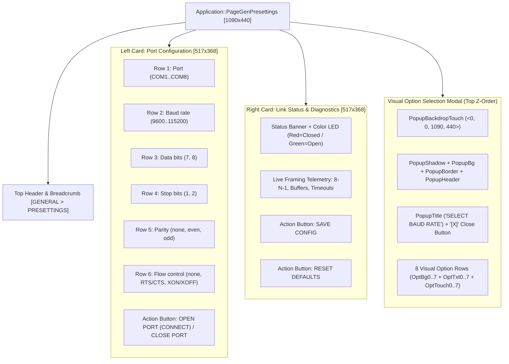

# Embedded Wizard Studio (EWS) - Presettings Screen Design Guide
## Designing the Serial Communication "Port Configuration" Screen Visually

---

### Welcome!
In industrial automation, medical devices, and laboratory instrumentation, configuring serial communication (RS-232, RS-422, or RS-485 Modbus) is a primary configuration screen.

This guide provides a **100% complete, beginner-friendly walkthrough** to design the **General &rarr; Presettings** screen (`Application::PageGenPresettings`) inside Embedded Wizard Studio.

> **Why this guide is visual and beginner-friendly:**
> In Embedded Wizard Studio, you do **not** need complex algebraic coordinate math in code to build dropdown inputs.
> A proper dropdown in Embedded Wizard is simply a **visual popup layer** placed directly in the Composer. You show or hide it using simple `.Visible = true` / `false`!

---

## Table of Contents
1. [Visual Screen Architecture](#1-visual-screen-architecture)
2. [Serial Communication Fundamentals (Friendly Engineering Note)](#2-serial-communication-fundamentals-friendly-engineering-note)
3. [The Visual Dropdown Pattern in Embedded Wizard Studio](#3-the-visual-dropdown-pattern-in-embedded-wizard-studio)
4. [Step 1: Screen Geometry & Base Containers](#step-1-screen-geometry--base-containers)
5. [Step 2: Designing the 6 Dropdown Fields (Left Panel)](#step-2-designing-the-6-dropdown-fields-left-panel)
6. [Step 3: Designing the Communication Diagnostics (Right Panel)](#step-3-designing-the-communication-diagnostics-right-panel)
7. [Step 4: Designing the Floating Selection Popup (Visual Overlay)](#step-4-designing-the-floating-selection-popup-visual-overlay)
8. [Step 5: State Variables & Complete Chora Code](#step-5-state-variables--complete-chora-code)
9. [Step 6: Testing in the Prototyper (F5)](#step-6-testing-in-the-prototyper-f5)

---

## 1. Visual Screen Architecture

The screen is built inside the component **`Application::PageGenPresettings`** (derived from `Core::Group`), occupying the active content canvas of `<0, 0, 1090, 440>`.



### Screen Budget Breakdown (`1090 x 440`):
* **Top Title Bar (`y: 0 to 46`)**: Header label `"General - Serial Port Configuration & Presettings"` and breadcrumb tag.
* **Left Card (`x: 18 to 535, y: 58 to 426`)**: The 6 dropdown field rows and the `OPEN PORT (CONNECT)` button.
* **Right Card (`x: 555 to 1072, y: 58 to 426`)**: Real-time link diagnostics, status LED, dynamic framing summary (`8-N-1`), and `SAVE CONFIG` / `RESET DEFAULTS` buttons.
* **Selection Popup Modal (`x: 172 to 516, y: 96 to 418`)**: A visual card layered on top in the Composer that displays the list of options when any dropdown field is tapped.

---

## 2. Serial Communication Fundamentals (Friendly Engineering Note)

> **Friendly Note - Why are these specific 6 parameters needed to establish communication?**
> Asynchronous serial communication (UART) does not transmit a shared clock wire between devices. Instead, both the transmitter and receiver must agree **in advance** on the exact timing and framing rules. If even one setting is mismatched, the incoming bits cannot be sampled, resulting in framing errors or garbled data.

| Parameter | Default | Options Available | Significance & Hardware Impact |
| :--- | :--- | :--- | :--- |
| **Port** | `COM3` | `COM1` .. `COM8` | Identifies the physical transceiver hardware (Windows COM3, Linux `/dev/ttyUSB0`, or MCU `USART1`..`USART8`). |
| **Baud rate** | `57600` | `9600`, `19200`, `38400`, `57600`, `115200` | Transmission speed in bits per second. Both sides' Baud Rate Generators (BRG) must match within &plusmn;2% tolerance. |
| **Data bits** | `8` | `7`, `8` | Payload bits per character frame. Standard binary protocols (Modbus RTU) require **8 data bits**; legacy ASCII uses **7**. |
| **Stop bits** | `1` | `1`, `2` | Idle-high stop marker at the end of each byte. 1 stop bit is standard; 2 stop bits provide extra margin on noisy lines. |
| **Parity** | `none` | `none`, `even`, `odd` | Error-checking bit appended to each frame. `none` = 8-N-1; `even`/`odd` detects single-bit line corruption. |
| **Flow control** | `none` | `none`, `RTS/CTS`, `XON/XOFF` | Prevents RX buffer overruns. `RTS/CTS` uses dedicated hardware handshake lines; `XON/XOFF` uses software flow characters (`0x11`/`0x13`). |

---

## 3. The Visual Dropdown Pattern in Embedded Wizard Studio

### How Embedded Wizard Renders Layers (Z-Order)
In Embedded Wizard, child objects are drawn in the order they appear in the Composer:
* Objects placed **earlier** are drawn in the background.
* Objects placed **later** are drawn in the foreground and receive touch events **first**.

Instead of writing complex code that computes coordinates and moves rectangles at runtime:
1. We design the **Selection Popup Modal** visually right inside the Composer at fixed coordinates (`<172, 96, 516, 418>`).
2. Initially, its `Visible` property is set to `false`.
3. When you tap **Baud rate**:
   * We set `PopupTitle.String = "SELECT BAUD RATE"`.
   * We show the options: `9600`, `19200`, `38400`, `57600`, `115200`.
   * We set `PopupBg.Visible = true`.
4. When you tap **57600**:
   * We save the choice, set `PopupBg.Visible = false`, and update the summary.
5. When you tap outside the popup (or tap `[X]`):
   * An invisible backdrop handler dismisses the menu cleanly.

---

## 4. Step 1: Screen Geometry & Base Containers

### 4.1 Open the Component in Embedded Wizard Studio
1. In the **Browser** tree (top-left), expand unit **`Application`**.
2. Double-click the class **`PageGenPresettings`**.
3. In the Inspector, verify its inherited property:
   * **`Bounds`**: `<0,0,1090,440>`

### 4.2 Add Screen Background & Title Bar
Drag the following views from Gallery &rarr; **Views**:

| Brick Type | Object Name | Bounds | Color | Properties / Notes |
| :--- | :--- | :--- | :--- | :--- |
| `Views::Rectangle` | `PageCardBg` | `<0,0,1090,440>` | `#151B27FF` | `Radius = 8` (Dark outer canvas background) |
| `Views::Border` | `PageCardBorder` | `<0,0,1090,440>` | `#263042FF` | `Width = 1`, `Radius = 8` |
| `Views::Rectangle` | `PageTitleBar` | `<0,0,1090,46>` | `#1C2434FF` | `RadiusTL = 8`, `RadiusTR = 8` |
| `Views::Line` | `PageTitleDivider`| `<0,46>` to `<1090,46>` | `#263042FF` | Divider line below title |
| `Views::Text` | `PageTitle` | `<20,8,650,38>` | `#F1F5F9FF` | `Font = FontCardTitle`, `String = "General - Serial Port Configuration & Presettings"` |
| `Views::Text` | `PageTag` | `<670,8,1070,38>` | `#38BDF8FF` | `Font = FontBadge`, `Alignment = AlignHorzRight`, `String = "GENERAL > PRESETTINGS"` |

---

## 5. Step 2: Designing the 6 Dropdown Fields (Left Panel)

### 5.1 Left Card Container
Drag from Gallery &rarr; **Views**:

| Brick Type | Object Name | Bounds | Color | Properties / Notes |
| :--- | :--- | :--- | :--- | :--- |
| `Views::Rectangle` | `LeftPanelBg` | `<18,58,535,426>` | `#1B2436FF` | `Radius = 6` |
| `Views::Border` | `LeftPanelBorder` | `<18,58,535,426>` | `#2C3A52FF` | `Width = 1`, `Radius = 6` |
| `Views::Rectangle` | `LeftPanelHeader` | `<18,58,535,94>` | `#212C42FF` | `RadiusTL = 6`, `RadiusTR = 6` |
| `Views::Text` | `LeftPanelTitle` | `<30,62,520,90>` | `#38BDF8FF` | `Font = FontCardTitle`, `String = "PORT CONFIGURATION"` |
| `Views::Text` | `LeftPanelSubtitle` | `<30,96,520,114>` | `#94A3B8FF` | `Font = FontBadge`, `String = "Tap any field to open selection menu:"` |

---

### 5.2 The 6 Dropdown Rows (Complete Table)
Every row is `34px` high with `42px` vertical spacing.
* The **Box** is a dark `Views::Rectangle` with `Radius = 4`.
* The **Border** is a `Views::Border`.
* The **Value** is a `Views::Text` showing the selected setting.
* The **Arrow** is a `Views::Text` showing `"v"`.
* The **Touch Handler** is a `Core::SimpleTouchHandler` placed over the box:

#### Row 1: Port (`y: 118 to 152`)
* `LabelPort` (`Views::Text`): `<35, 118, 175, 152>`, `Font = FontBody`, `String = "Port"`, `Color = #E2E8F0FF`.
* `ComboPortBg` (`Views::Rectangle`): `<180, 118, 515, 152>`, `Color = #0F172AFF`, `Radius = 4`.
* `ComboPortBorder` (`Views::Border`): `<180, 118, 515, 152>`, `Color = #334155FF`, `Width = 1`, `Radius = 4`.
* `TextPort` (`Views::Text`): `<195, 118, 475, 152>`, `Font = FontBody`, `String = "COM3"`, `Color = #38BDF8FF`.
* `ArrowPort` (`Views::Text`): `<480, 118, 510, 152>`, `Font = FontBadge`, `String = "v"`, `Color = #94A3B8FF`.
* `TouchPort` (`Core::SimpleTouchHandler`): `Point4 = <180, 118>`, `Point3 = <515, 118>`, `Point2 = <515, 152>`, `Point1 = <180, 152>`, `OnPress = onOpenPort`.

#### Row 2: Baud rate (`y: 160 to 194`)
* `LabelBaud` (`Views::Text`): `<35, 160, 175, 194>`, `Font = FontBody`, `String = "Baud rate"`, `Color = #E2E8F0FF`.
* `ComboBaudBg` (`Views::Rectangle`): `<180, 160, 515, 194>`, `Color = #0F172AFF`, `Radius = 4`.
* `ComboBaudBorder` (`Views::Border`): `<180, 160, 515, 194>`, `Color = #334155FF`, `Width = 1`, `Radius = 4`.
* `TextBaud` (`Views::Text`): `<195, 160, 475, 194>`, `Font = FontBody`, `String = "57600"`, `Color = #FFFFFFFF`.
* `ArrowBaud` (`Views::Text`): `<480, 160, 510, 194>`, `Font = FontBadge`, `String = "v"`, `Color = #94A3B8FF`.
* `TouchBaud` (`Core::SimpleTouchHandler`): `Point4 = <180, 160>`, `Point3 = <515, 160>`, `Point2 = <515, 194>`, `Point1 = <180, 194>`, `OnPress = onOpenBaud`.

#### Row 3: Data bits (`y: 202 to 236`)
* `LabelData` (`Views::Text`): `<35, 202, 175, 236>`, `Font = FontBody`, `String = "Data bits"`, `Color = #E2E8F0FF`.
* `ComboDataBg` (`Views::Rectangle`): `<180, 202, 515, 236>`, `Color = #0F172AFF`, `Radius = 4`.
* `ComboDataBorder` (`Views::Border`): `<180, 202, 515, 236>`, `Color = #334155FF`, `Width = 1`, `Radius = 4`.
* `TextDataBits` (`Views::Text`): `<195, 202, 475, 236>`, `Font = FontBody`, `String = "8"`, `Color = #FFFFFFFF`.
* `ArrowData` (`Views::Text`): `<480, 202, 510, 236>`, `Font = FontBadge`, `String = "v"`, `Color = #94A3B8FF`.
* `TouchData` (`Core::SimpleTouchHandler`): `Point4 = <180, 202>`, `Point3 = <515, 202>`, `Point2 = <515, 236>`, `Point1 = <180, 236>`, `OnPress = onOpenData`.

#### Row 4: Stop bits (`y: 244 to 278`)
* `LabelStop` (`Views::Text`): `<35, 244, 175, 278>`, `Font = FontBody`, `String = "Stop bits"`, `Color = #E2E8F0FF`.
* `ComboStopBg` (`Views::Rectangle`): `<180, 244, 515, 278>`, `Color = #0F172AFF`, `Radius = 4`.
* `ComboStopBorder` (`Views::Border`): `<180, 244, 515, 278>`, `Color = #334155FF`, `Width = 1`, `Radius = 4`.
* `TextStopBits` (`Views::Text`): `<195, 244, 475, 278>`, `Font = FontBody`, `String = "1"`, `Color = #FFFFFFFF`.
* `ArrowStop` (`Views::Text`): `<480, 244, 510, 278>`, `Font = FontBadge`, `String = "v"`, `Color = #94A3B8FF`.
* `TouchStop` (`Core::SimpleTouchHandler`): `Point4 = <180, 244>`, `Point3 = <515, 244>`, `Point2 = <515, 278>`, `Point1 = <180, 278>`, `OnPress = onOpenStop`.

#### Row 5: Parity (`y: 286 to 320`)
* `LabelParity` (`Views::Text`): `<35, 286, 175, 320>`, `Font = FontBody`, `String = "Parity"`, `Color = #E2E8F0FF`.
* `ComboParityBg` (`Views::Rectangle`): `<180, 286, 515, 320>`, `Color = #0F172AFF`, `Radius = 4`.
* `ComboParityBorder` (`Views::Border`): `<180, 286, 515, 320>`, `Color = #334155FF`, `Width = 1`, `Radius = 4`.
* `TextParity` (`Views::Text`): `<195, 286, 475, 320>`, `Font = FontBody`, `String = "none"`, `Color = #FFFFFFFF`.
* `ArrowParity` (`Views::Text`): `<480, 286, 510, 320>`, `Font = FontBadge`, `String = "v"`, `Color = #94A3B8FF`.
* `TouchParity` (`Core::SimpleTouchHandler`): `Point4 = <180, 286>`, `Point3 = <515, 286>`, `Point2 = <515, 320>`, `Point1 = <180, 320>`, `OnPress = onOpenParity`.

#### Row 6: Flow control (`y: 328 to 362`)
* `LabelFlow` (`Views::Text`): `<35, 328, 175, 362>`, `Font = FontBody`, `String = "Flow control"`, `Color = #E2E8F0FF`.
* `ComboFlowBg` (`Views::Rectangle`): `<180, 328, 515, 362>`, `Color = #0F172AFF`, `Radius = 4`.
* `ComboFlowBorder` (`Views::Border`): `<180, 328, 515, 362>`, `Color = #334155FF`, `Width = 1`, `Radius = 4`.
* `TextFlowControl` (`Views::Text`): `<195, 328, 475, 362>`, `Font = FontBody`, `String = "none"`, `Color = #FFFFFFFF`.
* `ArrowFlow` (`Views::Text`): `<480, 328, 510, 362>`, `Font = FontBadge`, `String = "v"`, `Color = #94A3B8FF`.
* `TouchFlow` (`Core::SimpleTouchHandler`): `Point4 = <180, 328>`, `Point3 = <515, 328>`, `Point2 = <515, 362>`, `Point1 = <180, 362>`, `OnPress = onOpenFlow`.

---

### 5.3 Connect Toggle Button (`y: 374 to 414`)
* `BtnConnectBg` (`Views::Rectangle`): `<180, 374, 515, 414>`, `Color = #0284C7FF`, `Radius = 4`.
* `TextConnectBtn` (`Views::Text`): `<180, 374, 515, 414>`, `Font = FontCardTitle`, `String = "OPEN PORT (CONNECT)"`, `Alignment = AlignHorzCenter`.
* `TouchConnect` (`Core::SimpleTouchHandler`): `Point4 = <180, 374>`, `Point3 = <515, 374>`, `Point2 = <515, 414>`, `Point1 = <180, 414>`, `OnPress = onToggleConnect`.

---

## 6. Step 3: Designing the Communication Diagnostics (Right Panel)

### 6.1 Right Card Container & Header
| Brick Type | Object Name | Bounds | Color | Properties / Notes |
| :--- | :--- | :--- | :--- | :--- |
| `Views::Rectangle` | `RightPanelBg` | `<555,58,1072,426>` | `#1B2436FF` | `Radius = 6` |
| `Views::Border` | `RightPanelBorder` | `<555,58,1072,426>` | `#2C3A52FF` | `Width = 1`, `Radius = 6` |
| `Views::Rectangle` | `RightPanelHeader` | `<555,58,1072,94>` | `#212C42FF` | `RadiusTL = 6`, `RadiusTR = 6` |
| `Views::Text` | `RightPanelTitle` | `<567,62,1055,90>` | `#38BDF8FF` | `Font = FontCardTitle`, `String = "COMMUNICATION LINK & DIAGNOSTICS"` |

### 6.2 Status Box & Color LED Indicator
* `StatusBoxBg` (`Views::Rectangle`): `<575, 106, 1052, 148>`, `Color = #0F172AFF`, `Radius = 4`.
* `StatusBoxBorder` (`Views::Border`): `<575, 106, 1052, 148>`, `Color = #334155FF`, `Width = 1`, `Radius = 4`.
* `LedStatus` (`Views::Rectangle`): `<590, 120, 606, 136>`, `Color = #EF4444FF` (Red), `Radius = 8` (Makes it circular!).
* `TextPortStatus` (`Views::Text`): `<618, 106, 1040, 148>`, `Font = FontCardTitle`, `String = "STATUS: CLOSED (Offline)"`, `Color = #F87171FF`.

### 6.3 Telemetry Summary Box
* `SummaryBg` (`Views::Rectangle`): `<575, 158, 1052, 362>`, `Color = #151D2EFF`, `Radius = 4`.
* `SummaryBorder` (`Views::Border`): `<575, 158, 1052, 362>`, `Color = #26334DFF`, `Width = 1`, `Radius = 4`.
* `TextConfigSummary` (`Views::Text`): `<590, 166, 1038, 354>`, `Font = FontBody`, `Color = #E2E8F0FF`, `WrapText = true`, `Alignment = AlignHorzLeft, AlignVertTop`.

### 6.4 Save & Reset Buttons
* `BtnSaveBg` (`Views::Rectangle`): `<575, 374, 805, 414>`, `Color = #1E293BFF`, `Radius = 4`.
* `BtnSaveBorder` (`Views::Border`): `<575, 374, 805, 414>`, `Color = #38BDF8FF`, `Width = 1`, `Radius = 4`.
* `TextSaveBtn` (`Views::Text`): `<575, 374, 805, 414>`, `Font = FontCardTitle`, `String = "SAVE CONFIG"`, `Color = #38BDF8FF`, `Alignment = AlignHorzCenter`.
* `TouchSave` (`Core::SimpleTouchHandler`): `<575, 374>` to `<805, 414>`, `OnPress = onSaveConfig`.

* `BtnResetBg` (`Views::Rectangle`): `<822, 374, 1052, 414>`, `Color = #1E293BFF`, `Radius = 4`.
* `BtnResetBorder` (`Views::Border`): `<822, 374, 1052, 414>`, `Color = #64748BFF`, `Width = 1`, `Radius = 4`.
* `TextResetBtn` (`Views::Text`): `<822, 374, 1052, 414>`, `Font = FontCardTitle`, `String = "RESET DEFAULTS"`, `Color = #94A3B8FF`, `Alignment = AlignHorzCenter`.
* `TouchReset` (`Core::SimpleTouchHandler`): `<822, 374>` to `<1052, 414>`, `OnPress = onResetDefault`.

---

## 7. Step 4: Designing the Floating Selection Popup (Visual Overlay)

> **Important EWS Order Rule**: Add these objects **last** in the Composer (or select them and choose **Arrange &rarr; Bring to Front**) so they sit in front of all other objects in Z-order!

### 7.1 Backdrop & Popup Frame
* **`PopupBackdropTouch`** (`Core::SimpleTouchHandler`): `<0, 0>` to `<1090, 440>`, `Enabled = false`, `OnPress = onClosePopup`.
  *(When the menu is open, this invisible screen-sized sensor catches taps outside the menu to close it!)*
* **`PopupShadow`** (`Views::Rectangle`): `<176, 100, 520, 422>`, `Color = #000000AA`, `Radius = 6`, `Visible = false`.
* **`PopupBg`** (`Views::Rectangle`): `<172, 96, 516, 418>`, `Color = #0F172AFF`, `Radius = 6`, `Visible = false`.
* **`PopupBorder`** (`Views::Border`): `<172, 96, 516, 418>`, `Color = #38BDF8FF`, `Width = 1`, `Radius = 6`, `Visible = false`.
* **`PopupHeader`** (`Views::Rectangle`): `<172, 96, 516, 132>`, `Color = #1E293BFF`, `RadiusTL = 6`, `RadiusTR = 6`, `Visible = false`.
* **`PopupTitle`** (`Views::Text`): `<184, 96, 470, 132>`, `Font = FontCardTitle`, `Color = #38BDF8FF`, `Visible = false`.
* **`PopupCloseText`** (`Views::Text`): `<474, 96, 512, 132>`, `Font = FontCardTitle`, `String = "[X]"`, `Color = #94A3B8FF`, `Visible = false`.
* **`PopupCloseTouch`** (`Core::SimpleTouchHandler`): `<470, 96>` to `<516, 132>`, `Enabled = false`, `OnPress = onClosePopup`.

---

### 7.2 The 8 Visual Option Rows
Each option row has a fixed position inside the popup frame (`y: 136` down to `408`, `32px` tall with `34px` spacing).
* All 8 rows start with `Visible = false` and `Enabled = false`.
* When an option is active, `OptBg` turns solid blue (`#0284C7FF`) and `OptTxt` turns bright white (`#FFFFFFFF`):

| Row | Rect Background (`OptBg{i}`) | Text View (`OptTxt{i}`) | Touch Handler (`OptTouch{i}`) | Touch Slot `OnPress` |
| :--- | :--- | :--- | :--- | :--- |
| **0** | `<176, 136, 512, 168>` | `<190, 136, 500, 168>` | `<176, 136>` to `<512, 168>` | `onSelectOpt0` |
| **1** | `<176, 170, 512, 202>` | `<190, 170, 500, 202>` | `<176, 170>` to `<512, 202>` | `onSelectOpt1` |
| **2** | `<176, 204, 512, 236>` | `<190, 204, 500, 236>` | `<176, 204>` to `<512, 236>` | `onSelectOpt2` |
| **3** | `<176, 238, 512, 270>` | `<190, 238, 500, 270>` | `<176, 238>` to `<512, 270>` | `onSelectOpt3` |
| **4** | `<176, 272, 512, 304>` | `<190, 272, 500, 304>` | `<176, 272>` to `<512, 304>` | `onSelectOpt4` |
| **5** | `<176, 306, 512, 338>` | `<190, 306, 500, 338>` | `<176, 306>` to `<512, 338>` | `onSelectOpt5` |
| **6** | `<176, 340, 512, 372>` | `<190, 340, 500, 372>` | `<176, 340>` to `<512, 372>` | `onSelectOpt6` |
| **7** | `<176, 374, 512, 406>` | `<190, 374, 500, 406>` | `<176, 374>` to `<512, 406>` | `onSelectOpt7` |

---

## 8. Step 5: State Variables & Complete Chora Code

Drag from Gallery &rarr; **Chora**:

### 8.1 State Variables
```chora
var int32 SelectedPortIndex   = 2; // Default: COM3
var int32 SelectedBaudIndex   = 3; // Default: 57600
var int32 SelectedDataIndex   = 1; // Default: 8
var int32 SelectedStopIndex   = 0; // Default: 1
var int32 SelectedParityIndex = 0; // Default: none
var int32 SelectedFlowIndex   = 0; // Default: none
var bool  IsPortOpen          = false;
var int32 ActiveMenu          = 0; // 0=None, 1=Port, 2=Baud, 3=Data, 4=Stop, 5=Parity, 6=Flow
var bool  JustSaved           = false;
```

---

### 8.2 Lifecycle Startup Hook
```chora
// Overrides the component's startup lifecycle method
inherited method Init()
{
  UpdateUI();
}
```

---

### 8.3 Helper Method: `SetItem(...)`
Shows or hides a single option row and applies selection colors:
```chora
method void SetItem( arg int32 aIndex, arg bool aShow, arg string aLabel, arg bool aSelected )
{
  if ( aIndex == 0 )
  {
    OptBg0.Visible    = aShow;
    OptTxt0.Visible   = aShow;
    OptTouch0.Enabled = aShow;
    if ( aShow )
    {
      OptTxt0.String = aLabel;
      OptBg0.Color   = aSelected ? #0284C7FF : #0F172AFF;
      OptTxt0.Color  = aSelected ? #FFFFFFFF : #CBD5E1FF;
    }
  }

  if ( aIndex == 1 )
  {
    OptBg1.Visible    = aShow;
    OptTxt1.Visible   = aShow;
    OptTouch1.Enabled = aShow;
    if ( aShow )
    {
      OptTxt1.String = aLabel;
      OptBg1.Color   = aSelected ? #0284C7FF : #0F172AFF;
      OptTxt1.Color  = aSelected ? #FFFFFFFF : #CBD5E1FF;
    }
  }

  if ( aIndex == 2 )
  {
    OptBg2.Visible    = aShow;
    OptTxt2.Visible   = aShow;
    OptTouch2.Enabled = aShow;
    if ( aShow )
    {
      OptTxt2.String = aLabel;
      OptBg2.Color   = aSelected ? #0284C7FF : #0F172AFF;
      OptTxt2.Color  = aSelected ? #FFFFFFFF : #CBD5E1FF;
    }
  }

  if ( aIndex == 3 )
  {
    OptBg3.Visible    = aShow;
    OptTxt3.Visible   = aShow;
    OptTouch3.Enabled = aShow;
    if ( aShow )
    {
      OptTxt3.String = aLabel;
      OptBg3.Color   = aSelected ? #0284C7FF : #0F172AFF;
      OptTxt3.Color  = aSelected ? #FFFFFFFF : #CBD5E1FF;
    }
  }

  if ( aIndex == 4 )
  {
    OptBg4.Visible    = aShow;
    OptTxt4.Visible   = aShow;
    OptTouch4.Enabled = aShow;
    if ( aShow )
    {
      OptTxt4.String = aLabel;
      OptBg4.Color   = aSelected ? #0284C7FF : #0F172AFF;
      OptTxt4.Color  = aSelected ? #FFFFFFFF : #CBD5E1FF;
    }
  }

  if ( aIndex == 5 )
  {
    OptBg5.Visible    = aShow;
    OptTxt5.Visible   = aShow;
    OptTouch5.Enabled = aShow;
    if ( aShow )
    {
      OptTxt5.String = aLabel;
      OptBg5.Color   = aSelected ? #0284C7FF : #0F172AFF;
      OptTxt5.Color  = aSelected ? #FFFFFFFF : #CBD5E1FF;
    }
  }

  if ( aIndex == 6 )
  {
    OptBg6.Visible    = aShow;
    OptTxt6.Visible   = aShow;
    OptTouch6.Enabled = aShow;
    if ( aShow )
    {
      OptTxt6.String = aLabel;
      OptBg6.Color   = aSelected ? #0284C7FF : #0F172AFF;
      OptTxt6.Color  = aSelected ? #FFFFFFFF : #CBD5E1FF;
    }
  }

  if ( aIndex == 7 )
  {
    OptBg7.Visible    = aShow;
    OptTxt7.Visible   = aShow;
    OptTouch7.Enabled = aShow;
    if ( aShow )
    {
      OptTxt7.String = aLabel;
      OptBg7.Color   = aSelected ? #0284C7FF : #0F172AFF;
      OptTxt7.Color  = aSelected ? #FFFFFFFF : #CBD5E1FF;
    }
  }
}
```

---

### 8.4 The Master Method: `UpdateUI()`
Updates all labels, toggles field border highlights, populates the option modal, and updates diagnostics:
```chora
method void UpdateUI()
{
  // 1. Update text of the 6 fields
  if ( SelectedPortIndex == 0 ) TextPort.String = "COM1";
  if ( SelectedPortIndex == 1 ) TextPort.String = "COM2";
  if ( SelectedPortIndex == 2 ) TextPort.String = "COM3";
  if ( SelectedPortIndex == 3 ) TextPort.String = "COM4";
  if ( SelectedPortIndex == 4 ) TextPort.String = "COM5";
  if ( SelectedPortIndex == 5 ) TextPort.String = "COM6";
  if ( SelectedPortIndex == 6 ) TextPort.String = "COM7";
  if ( SelectedPortIndex == 7 ) TextPort.String = "COM8";

  if ( SelectedBaudIndex == 0 ) TextBaud.String = "9600";
  if ( SelectedBaudIndex == 1 ) TextBaud.String = "19200";
  if ( SelectedBaudIndex == 2 ) TextBaud.String = "38400";
  if ( SelectedBaudIndex == 3 ) TextBaud.String = "57600";
  if ( SelectedBaudIndex == 4 ) TextBaud.String = "115200";

  if ( SelectedDataIndex == 0 ) TextDataBits.String = "7";
  if ( SelectedDataIndex == 1 ) TextDataBits.String = "8";

  if ( SelectedStopIndex == 0 ) TextStopBits.String = "1";
  if ( SelectedStopIndex == 1 ) TextStopBits.String = "2";

  if ( SelectedParityIndex == 0 ) TextParity.String = "none";
  if ( SelectedParityIndex == 1 ) TextParity.String = "even";
  if ( SelectedParityIndex == 2 ) TextParity.String = "odd";

  if ( SelectedFlowIndex == 0 ) TextFlowControl.String = "none";
  if ( SelectedFlowIndex == 1 ) TextFlowControl.String = "RTS/CTS";
  if ( SelectedFlowIndex == 2 ) TextFlowControl.String = "XON/XOFF";

  // 2. Highlight active field border and arrow
  ComboPortBorder.Color   = ( ActiveMenu == 1 ) ? #38BDF8FF : #334155FF;
  ArrowPort.String        = ( ActiveMenu == 1 ) ? "^" : "v";
  ArrowPort.Color         = ( ActiveMenu == 1 ) ? #38BDF8FF : #94A3B8FF;

  ComboBaudBorder.Color   = ( ActiveMenu == 2 ) ? #38BDF8FF : #334155FF;
  ArrowBaud.String        = ( ActiveMenu == 2 ) ? "^" : "v";
  ArrowBaud.Color         = ( ActiveMenu == 2 ) ? #38BDF8FF : #94A3B8FF;

  ComboDataBorder.Color   = ( ActiveMenu == 3 ) ? #38BDF8FF : #334155FF;
  ArrowData.String        = ( ActiveMenu == 3 ) ? "^" : "v";
  ArrowData.Color         = ( ActiveMenu == 3 ) ? #38BDF8FF : #94A3B8FF;

  ComboStopBorder.Color   = ( ActiveMenu == 4 ) ? #38BDF8FF : #334155FF;
  ArrowStop.String        = ( ActiveMenu == 4 ) ? "^" : "v";
  ArrowStop.Color         = ( ActiveMenu == 4 ) ? #38BDF8FF : #94A3B8FF;

  ComboParityBorder.Color = ( ActiveMenu == 5 ) ? #38BDF8FF : #334155FF;
  ArrowParity.String      = ( ActiveMenu == 5 ) ? "^" : "v";
  ArrowParity.Color       = ( ActiveMenu == 5 ) ? #38BDF8FF : #94A3B8FF;

  ComboFlowBorder.Color   = ( ActiveMenu == 6 ) ? #38BDF8FF : #334155FF;
  ArrowFlow.String        = ( ActiveMenu == 6 ) ? "^" : "v";
  ArrowFlow.Color         = ( ActiveMenu == 6 ) ? #38BDF8FF : #94A3B8FF;

  // 3. Toggle popup modal visibility
  var bool showPopup = ( ActiveMenu > 0 );
  PopupBackdropTouch.Enabled = showPopup;
  PopupShadow.Visible        = showPopup;
  PopupBg.Visible            = showPopup;
  PopupBorder.Visible        = showPopup;
  PopupHeader.Visible        = showPopup;
  PopupTitle.Visible         = showPopup;
  PopupCloseText.Visible     = showPopup;
  PopupCloseTouch.Enabled    = showPopup;

  if ( !showPopup )
  {
    SetItem( 0, false, "", false );
    SetItem( 1, false, "", false );
    SetItem( 2, false, "", false );
    SetItem( 3, false, "", false );
    SetItem( 4, false, "", false );
    SetItem( 5, false, "", false );
    SetItem( 6, false, "", false );
    SetItem( 7, false, "", false );
  }
  else
  {
    if ( ActiveMenu == 1 )
    {
      PopupTitle.String = "SELECT SERIAL PORT";
      SetItem( 0, true, "COM1", SelectedPortIndex == 0 );
      SetItem( 1, true, "COM2", SelectedPortIndex == 1 );
      SetItem( 2, true, "COM3", SelectedPortIndex == 2 );
      SetItem( 3, true, "COM4", SelectedPortIndex == 3 );
      SetItem( 4, true, "COM5", SelectedPortIndex == 4 );
      SetItem( 5, true, "COM6", SelectedPortIndex == 5 );
      SetItem( 6, true, "COM7", SelectedPortIndex == 6 );
      SetItem( 7, true, "COM8", SelectedPortIndex == 7 );
    }

    if ( ActiveMenu == 2 )
    {
      PopupTitle.String = "SELECT BAUD RATE";
      SetItem( 0, true, "9600 bps",   SelectedBaudIndex == 0 );
      SetItem( 1, true, "19200 bps",  SelectedBaudIndex == 1 );
      SetItem( 2, true, "38400 bps",  SelectedBaudIndex == 2 );
      SetItem( 3, true, "57600 bps",  SelectedBaudIndex == 3 );
      SetItem( 4, true, "115200 bps", SelectedBaudIndex == 4 );
      SetItem( 5, false, "", false );
      SetItem( 6, false, "", false );
      SetItem( 7, false, "", false );
    }

    if ( ActiveMenu == 3 )
    {
      PopupTitle.String = "SELECT DATA BITS";
      SetItem( 0, true, "7 Data Bits", SelectedDataIndex == 0 );
      SetItem( 1, true, "8 Data Bits", SelectedDataIndex == 1 );
      SetItem( 2, false, "", false );
      SetItem( 3, false, "", false );
      SetItem( 4, false, "", false );
      SetItem( 5, false, "", false );
      SetItem( 6, false, "", false );
      SetItem( 7, false, "", false );
    }

    if ( ActiveMenu == 4 )
    {
      PopupTitle.String = "SELECT STOP BITS";
      SetItem( 0, true, "1 Stop Bit",  SelectedStopIndex == 0 );
      SetItem( 1, true, "2 Stop Bits", SelectedStopIndex == 1 );
      SetItem( 2, false, "", false );
      SetItem( 3, false, "", false );
      SetItem( 4, false, "", false );
      SetItem( 5, false, "", false );
      SetItem( 6, false, "", false );
      SetItem( 7, false, "", false );
    }

    if ( ActiveMenu == 5 )
    {
      PopupTitle.String = "SELECT PARITY";
      SetItem( 0, true, "none (No Parity)",   SelectedParityIndex == 0 );
      SetItem( 1, true, "even (Even Parity)", SelectedParityIndex == 1 );
      SetItem( 2, true, "odd (Odd Parity)",   SelectedParityIndex == 2 );
      SetItem( 3, false, "", false );
      SetItem( 4, false, "", false );
      SetItem( 5, false, "", false );
      SetItem( 6, false, "", false );
      SetItem( 7, false, "", false );
    }

    if ( ActiveMenu == 6 )
    {
      PopupTitle.String = "SELECT FLOW CONTROL";
      SetItem( 0, true, "none (No Flow Control)",          SelectedFlowIndex == 0 );
      SetItem( 1, true, "RTS/CTS (Hardware Handshake)",    SelectedFlowIndex == 1 );
      SetItem( 2, true, "XON/XOFF (Software Handshake)",   SelectedFlowIndex == 2 );
      SetItem( 3, false, "", false );
      SetItem( 4, false, "", false );
      SetItem( 5, false, "", false );
      SetItem( 6, false, "", false );
      SetItem( 7, false, "", false );
    }
  }

  // 4. Connection State
  if ( IsPortOpen )
  {
    LedStatus.Color       = #10B981FF;
    TextPortStatus.String = "STATUS: OPEN & READY";
    TextPortStatus.Color  = #34D399FF;
    BtnConnectBg.Color    = #059669FF;
    TextConnectBtn.String = "CLOSE PORT (DISCONNECT)";
  }
  else
  {
    LedStatus.Color       = #EF4444FF;
    TextPortStatus.String = "STATUS: CLOSED (Offline)";
    TextPortStatus.Color  = #F87171FF;
    BtnConnectBg.Color    = #0284C7FF;
    TextConnectBtn.String = "OPEN PORT (CONNECT)";
  }

  // 5. Update Telemetry Summary
  var string parityStr = TextParity.String;
  var string pCode = "N";
  if ( SelectedParityIndex == 1 ) pCode = "E";
  if ( SelectedParityIndex == 2 ) pCode = "O";

  var string connStr = IsPortOpen ? "ESTABLISHED (Active Transmission)" : "STANDBY (Port Not Opened)";
  var string diagStr = JustSaved ? "Configuration saved to non-volatile EEPROM!" : "Config ready for UART Peripheral";

  TextConfigSummary.String = "Active Port:       " + TextPort.String + " (Physical RS-232 / RS-485)\n"
                           + "Baud Rate:         " + TextBaud.String + " bps\n"
                           + "Data Framing:      " + TextDataBits.String + "-" + pCode + "-" + TextStopBits.String + " (" + TextDataBits.String + " Data, " + parityStr + " Parity, " + TextStopBits.String + " Stop)\n"
                           + "Flow Control:      " + TextFlowControl.String + "\n"
                           + "Connection State:  " + connStr + "\n"
                           + "RX Buffer Size:    4096 Bytes (FIFO Queue Active)\n"
                           + "TX Buffer Size:    4096 Bytes (FIFO Queue Active)\n"
                           + "Read Timeout:      500 ms (Non-Blocking Polling)\n"
                           + "Write Timeout:     250 ms (Direct Bus Flush)\n"
                           + "Diagnostic Status: " + diagStr;
}
```

---

### 8.5 Slots (Touch Action Handlers)

#### Open & Close Slots:
```chora
// Open/toggle Port menu (Menu ID 1)
slot onOpenPort
{
  ActiveMenu = ( ActiveMenu == 1 ) ? 0 : 1;
  UpdateUI();
}

// Open/toggle Baud rate menu (Menu ID 2)
slot onOpenBaud
{
  ActiveMenu = ( ActiveMenu == 2 ) ? 0 : 2;
  UpdateUI();
}

// Open/toggle Data bits menu (Menu ID 3)
slot onOpenData
{
  ActiveMenu = ( ActiveMenu == 3 ) ? 0 : 3;
  UpdateUI();
}

// Open/toggle Stop bits menu (Menu ID 4)
slot onOpenStop
{
  ActiveMenu = ( ActiveMenu == 4 ) ? 0 : 4;
  UpdateUI();
}

// Open/toggle Parity menu (Menu ID 5)
slot onOpenParity
{
  ActiveMenu = ( ActiveMenu == 5 ) ? 0 : 5;
  UpdateUI();
}

// Open/toggle Flow control menu (Menu ID 6)
slot onOpenFlow
{
  ActiveMenu = ( ActiveMenu == 6 ) ? 0 : 6;
  UpdateUI();
}

// Dismiss popup (when tapping [X] or tapping backdrop)
slot onClosePopup
{
  ActiveMenu = 0;
  UpdateUI();
}
```

#### Option Selection Slots (Rows 0 to 7):
When the user taps an option row inside the popup, it applies the selected index to whichever menu is currently open:
```chora
slot onSelectOpt0
{
  if ( ActiveMenu == 1 ) SelectedPortIndex   = 0;
  if ( ActiveMenu == 2 ) SelectedBaudIndex   = 0;
  if ( ActiveMenu == 3 ) SelectedDataIndex   = 0;
  if ( ActiveMenu == 4 ) SelectedStopIndex   = 0;
  if ( ActiveMenu == 5 ) SelectedParityIndex = 0;
  if ( ActiveMenu == 6 ) SelectedFlowIndex   = 0;
  ActiveMenu = 0;
  JustSaved  = false;
  UpdateUI();
}

slot onSelectOpt1
{
  if ( ActiveMenu == 1 ) SelectedPortIndex   = 1;
  if ( ActiveMenu == 2 ) SelectedBaudIndex   = 1;
  if ( ActiveMenu == 3 ) SelectedDataIndex   = 1;
  if ( ActiveMenu == 4 ) SelectedStopIndex   = 1;
  if ( ActiveMenu == 5 ) SelectedParityIndex = 1;
  if ( ActiveMenu == 6 ) SelectedFlowIndex   = 1;
  ActiveMenu = 0;
  JustSaved  = false;
  UpdateUI();
}

slot onSelectOpt2
{
  if ( ActiveMenu == 1 ) SelectedPortIndex   = 2;
  if ( ActiveMenu == 2 ) SelectedBaudIndex   = 2;
  if ( ActiveMenu == 3 ) SelectedDataIndex   = 2;
  if ( ActiveMenu == 4 ) SelectedStopIndex   = 2;
  if ( ActiveMenu == 5 ) SelectedParityIndex = 2;
  if ( ActiveMenu == 6 ) SelectedFlowIndex   = 2;
  ActiveMenu = 0;
  JustSaved  = false;
  UpdateUI();
}

slot onSelectOpt3
{
  if ( ActiveMenu == 1 ) SelectedPortIndex   = 3;
  if ( ActiveMenu == 2 ) SelectedBaudIndex   = 3;
  if ( ActiveMenu == 3 ) SelectedDataIndex   = 3;
  if ( ActiveMenu == 4 ) SelectedStopIndex   = 3;
  if ( ActiveMenu == 5 ) SelectedParityIndex = 3;
  if ( ActiveMenu == 6 ) SelectedFlowIndex   = 3;
  ActiveMenu = 0;
  JustSaved  = false;
  UpdateUI();
}

slot onSelectOpt4
{
  if ( ActiveMenu == 1 ) SelectedPortIndex   = 4;
  if ( ActiveMenu == 2 ) SelectedBaudIndex   = 4;
  if ( ActiveMenu == 3 ) SelectedDataIndex   = 4;
  if ( ActiveMenu == 4 ) SelectedStopIndex   = 4;
  if ( ActiveMenu == 5 ) SelectedParityIndex = 4;
  if ( ActiveMenu == 6 ) SelectedFlowIndex   = 4;
  ActiveMenu = 0;
  JustSaved  = false;
  UpdateUI();
}

slot onSelectOpt5
{
  if ( ActiveMenu == 1 ) SelectedPortIndex   = 5;
  if ( ActiveMenu == 2 ) SelectedBaudIndex   = 5;
  if ( ActiveMenu == 3 ) SelectedDataIndex   = 5;
  if ( ActiveMenu == 4 ) SelectedStopIndex   = 5;
  if ( ActiveMenu == 5 ) SelectedParityIndex = 5;
  if ( ActiveMenu == 6 ) SelectedFlowIndex   = 5;
  ActiveMenu = 0;
  JustSaved  = false;
  UpdateUI();
}

slot onSelectOpt6
{
  if ( ActiveMenu == 1 ) SelectedPortIndex   = 6;
  if ( ActiveMenu == 2 ) SelectedBaudIndex   = 6;
  if ( ActiveMenu == 3 ) SelectedDataIndex   = 6;
  if ( ActiveMenu == 4 ) SelectedStopIndex   = 6;
  if ( ActiveMenu == 5 ) SelectedParityIndex = 6;
  if ( ActiveMenu == 6 ) SelectedFlowIndex   = 6;
  ActiveMenu = 0;
  JustSaved  = false;
  UpdateUI();
}

slot onSelectOpt7
{
  if ( ActiveMenu == 1 ) SelectedPortIndex   = 7;
  if ( ActiveMenu == 2 ) SelectedBaudIndex   = 7;
  if ( ActiveMenu == 3 ) SelectedDataIndex   = 7;
  if ( ActiveMenu == 4 ) SelectedStopIndex   = 7;
  if ( ActiveMenu == 5 ) SelectedParityIndex = 7;
  if ( ActiveMenu == 6 ) SelectedFlowIndex   = 7;
  ActiveMenu = 0;
  JustSaved  = false;
  UpdateUI();
}
```

#### Button Action Slots:
```chora
// Toggle Open/Close Port
slot onToggleConnect
{
  ActiveMenu = 0;
  IsPortOpen = !IsPortOpen;
  UpdateUI();
}

// Save Configuration
slot onSaveConfig
{
  ActiveMenu = 0;
  JustSaved  = true;
  UpdateUI();
}

// Reset to Defaults (COM3, 57600, 8, 1, none, none)
slot onResetDefault
{
  SelectedPortIndex   = 2; // COM3
  SelectedBaudIndex   = 3; // 57600
  SelectedDataIndex   = 1; // 8
  SelectedStopIndex   = 0; // 1
  SelectedParityIndex = 0; // none
  SelectedFlowIndex   = 0; // none
  IsPortOpen          = false;
  ActiveMenu          = 0;
  JustSaved           = false;
  UpdateUI();
}
```

---

## 9. Step 6: Testing in the Prototyper (F5)

1. Open [SerialComEWS.ewp](file:///c:/Users/vijay/Desktop/EWS_Projects/SerialCommunications/SerialComEWS/SerialComEWS.ewp) in Embedded Wizard Studio.
2. Press **`F5`** (or **`Ctrl + F5`**) to launch the Prototyper.
3. Tap **General** in the top navigation, then tap **Presettings** in the secondary sub-bar.
4. Test the visual dropdown behavior:
   * Tap **Port** (`COM3 v`):
     - The field glows cyan (`^`).
     - The selection modal appears titled `"SELECT SERIAL PORT"` with rows `COM1` through `COM8`.
     - `COM3` is highlighted in solid blue.
     - Tap `COM5` &rarr; The modal dismisses, `TextPort` becomes `COM5`, and the diagnostics card updates immediately!
   * Tap **Baud rate** (`57600 v`):
     - The modal opens titled `"SELECT BAUD RATE"` showing `9600 bps`, `19200 bps`, `38400 bps`, `57600 bps`, and `115200 bps`.
     - Tap `115200 bps` &rarr; Applied!
   * Tap **`[X]`** or tap anywhere outside the modal &rarr; Closes cleanly without clicking buttons behind it.
   * Tap **`OPEN PORT (CONNECT)`** &rarr; LED turns green (`STATUS: OPEN & READY`), button switches to `CLOSE PORT (DISCONNECT)`.
   * Tap **`RESET DEFAULTS`** &rarr; Restores settings back to `COM3`, `57600`, `8`, `1`, `none`, `none`.
