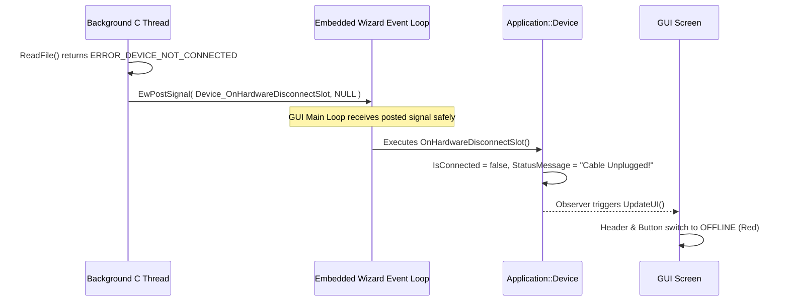

# Embedded Wizard: Serial Port Backend Integration Guide
## Connecting Presettings UI to Native C Serial Drivers & Live State Synchronization

This comprehensive guide explains how to pass serial port configuration parameters (**Port**, **Baud Rate**, **Data Bits**, **Stop Bits**, **Parity**, and **Flow Control**) from the **Embedded Wizard UI** to a native **C/C++ backend**, execute the hardware connection, and synchronize the **Connection State** back to the UI in real time.

---

## 1. Architectural Model: The Device Driver Pattern

In Embedded Wizard, the GUI application running in the Chora runtime must **never** directly access low-level OS handles, hardware registers, or blocking system calls. Instead, Embedded Wizard employs the **Device Driver Pattern**:

```
+--------------------------------------------------------------------------------+
|                             EMBEDDED WIZARD UI (CHORA)                         |
|                                                                                |
|   [PageGenPresettings]                  [Application Header]                   |
|   - Dropdown selections                 - HeaderPort label ("COM3: 57600")     |
|   - "OPEN PORT" Button                  - HeaderStatus badge ("ONLINE")        |
|   - Status LED & Diagnostics            - Online status icon                   |
+------------------------------------+-------------------------------------------+
                                     |
               Reads & Observes via  |  Calls Methods
               Property Observers    |  (e.g., OpenPort, ClosePort)
                                     v
+--------------------------------------------------------------------------------+
|                      DEVICE INTERFACE BRIDGE (CHORA AUTOOBJECT)                |
|                                                                                |
|   Application::DeviceClass (Singleton: Application::Device)                    |
|   - Properties: IsConnected, PortName, BaudRate, DataBits, RxCount, TxCount   |
|   - Methods:    OpenPort(), ClosePort(), SendData()                            |
|   - Simulation: Prototyper fallback ($if $prototyper)                          |
+------------------------------------+-------------------------------------------+
                                     |
                      native (...)   |  EwPostSignal() / Callback
                      C Code Blocks  |  Thread-safe UI Notification
                                     v
+--------------------------------------------------------------------------------+
|                         NATIVE HARDWARE BACKEND (C / C++)                      |
|                                                                                |
|   SerialDriver.c / SerialDriver.h                                              |
|   - Windows: Win32 API (CreateFile, SetCommState, DCB, COMMTIMEOUTS)           |
|   - Linux:   POSIX termios (/dev/ttyUSB0, tcsetattr)                           |
|   - MCU:     Bare-metal / FreeRTOS HAL (STM32 HAL_UART_Init, NXP, ESP32)       |
+--------------------------------------------------------------------------------+
```

### Complete End-to-End Sequence Diagram

```mermaid
sequenceDiagram
    autonumber
    actor User as Operator
    participant UI as PageGenPresettings (UI)
    participant Dev as Application::Device (Chora)
    participant Native as SerialDriver.c (Native C)
    participant HW as Hardware / Win32 COM

    User->>UI: Selects COM3, 57600, 8-N-1, None
    User->>UI: Clicks "OPEN PORT (CONNECT)"
    UI->>Dev: OpenPort("COM3", 57600, 8, 1, 0, 0)
    Dev->>Native: native { SerialDriver_Open("COM3", 57600, 8, 1, 0, 0); }
    Native->>HW: CreateFileA("\\.\COM3") & SetCommState(DCB)
    HW-->>Native: Handle opened (SUCCESS)
    Native-->>Dev: Returns 1 (true)
    Dev->>Dev: IsConnected = true, PortName = "COM3"
    Dev-->>UI: Property Observer Notification (IsConnected changed)
    UI->>UI: UpdateUI()
    Note over UI: Button turns GREEN ("CLOSE PORT")<br/>LED turns GREEN (Active)<br/>Summary updates with live framing
```

---

## 2. Step 1: Create the Chora Device Driver Class

In your Embedded Wizard unit (e.g., `Application`), create a class named `DeviceClass` and a global autoobject singleton named `Device`.

### 2.1 Class Definition (`Application::DeviceClass`)

In Chora, define the properties and connection methods:

```chora
// ============================================================================
// Class: Application::DeviceClass
// Bridge between Embedded Wizard GUI and Native C Serial Communications Driver
// ============================================================================
class DeviceClass
{
  // --------------------------------------------------------------------------
  // Connection State Properties (Observed by UI)
  // --------------------------------------------------------------------------
  $category @Connection State
  property bool IsConnected = false;

  $category @Connection State
  property string PortName = "COM3";

  $category @Connection State
  property int32 BaudRate = 57600;

  $category @Connection State
  property int32 DataBits = 8;

  $category @Connection State
  property int32 StopBits = 1;

  $category @Connection State
  property int32 Parity = 0; // 0=None, 1=Even, 2=Odd

  $category @Connection State
  property int32 FlowControl = 0; // 0=None, 1=RTS/CTS, 2=XON/XOFF

  $category @Diagnostics
  property string StatusMessage = "Port Closed (Standby)";

  $category @Diagnostics
  property int32 RxByteCount = 0;

  $category @Diagnostics
  property int32 TxByteCount = 0;

  // --------------------------------------------------------------------------
  // Method: OpenPort
  // Passes UI configuration parameters to the native serial driver
  // --------------------------------------------------------------------------
  method bool OpenPort( arg string aPort, arg int32 aBaud, arg int32 aDataBits,
                        arg int32 aStopBits, arg int32 aParity, arg int32 aFlow )
  {
    var bool result = false;

    // 1. Prototyper Simulation Mode (Inside Embedded Wizard Studio on PC)
    $if $prototyper
      // Simulate successful hardware opening
      trace "PROTOTYPER SIMULATION: Opening Serial Port:", aPort, "@", aBaud, "bps";
      result = true;
    $endif

    // 2. Real Native Target Mode (Windows Host or Embedded MCU Target)
    $if !$prototyper
      native ( aPort, aBaud, aDataBits, aStopBits, aParity, aFlow, result )
      {
        /* Convert Chora string to C ANSI char pointer */
        char portBuf[32];
        EwCopyString( portBuf, sizeof( portBuf ), aPort );

        /* Call the native C driver function */
        int res = SerialDriver_Open( portBuf, aBaud, aDataBits, aStopBits, aParity, aFlow );
        result = ( res == 1 ) ? 1 : 0;
      }
    $endif

    // 3. Update Internal State if successful
    if ( result )
    {
      PortName      = aPort;
      BaudRate      = aBaud;
      DataBits      = aDataBits;
      StopBits      = aStopBits;
      Parity        = aParity;
      FlowControl   = aFlow;
      StatusMessage = "CONNECTED: " + aPort + " @ " + string( aBaud ) + " bps";
      IsConnected   = true; // Triggers UI observers automatically!
    }
    else
    {
      StatusMessage = "ERROR: Failed to open " + aPort;
      IsConnected   = false;
    }

    return result;
  }

  // --------------------------------------------------------------------------
  // Method: ClosePort
  // Closes the active hardware serial port
  // --------------------------------------------------------------------------
  method void ClosePort()
  {
    $if $prototyper
      trace "PROTOTYPER SIMULATION: Closing Serial Port:", PortName;
    $endif

    $if !$prototyper
      native ()
      {
        SerialDriver_Close();
      }
    $endif

    IsConnected   = false; // Triggers UI observers automatically!
    StatusMessage = "Port Closed (Offline)";
  }
}
```

### 2.2 Global Autoobject (`Application::Device`)

Create an autoobject named `Device` of class `Application::DeviceClass`:
```chora
$rect <460,70,660,110>
autoobject Application::DeviceClass Device;
```
> [!NOTE]
> An **autoobject** in Embedded Wizard is a globally accessible singleton instance. Any UI component anywhere in the project can directly reference `Application::Device.IsConnected` or call `Application::Device.OpenPort(...)`.

---

## 3. Step 2: Pass Parameters from Presettings Screen to Backend

In `Application::PageGenPresettings`, map the user's dropdown selections to concrete values and pass them when the **Connect Button** is pressed.

### 3.1 Mapping Selection Indices to Concrete Values

In `PageGenPresettings`, add a helper method `GetBaudValue()` to map `SelectedBaudIndex` to standard baud numbers:

```chora
// Helper method inside PageGenPresettings: GetBaudValue
method int32 GetBaudValue()
{
  if ( SelectedBaudIndex == 0 ) return 9600;
  if ( SelectedBaudIndex == 1 ) return 19200;
  if ( SelectedBaudIndex == 2 ) return 38400;
  if ( SelectedBaudIndex == 3 ) return 57600;
  if ( SelectedBaudIndex == 4 ) return 115200;
  return 57600; // Default fallback
}
```

Mapping summary table for all 6 parameters:

| Parameter | Dropdown Selection Index | Chora Variable / Value Sent to Backend |
| :--- | :--- | :--- |
| **Port** | `0 .. 7` | `TextPort.String` &rarr; `"COM1"` .. `"COM8"` |
| **Baud Rate** | `0, 1, 2, 3, 4` | `GetBaudValue()` &rarr; `9600`, `19200`, `38400`, `57600`, `115200` |
| **Data Bits** | `0` (7 Bits), `1` (8 Bits) | `(SelectedDataIndex == 0) ? 7 : 8` |
| **Stop Bits** | `0` (1 Stop Bit), `1` (2 Stop Bits) | `(SelectedStopIndex == 0) ? 1 : 2` |
| **Parity** | `0` (None), `1` (Even), `2` (Odd) | `SelectedParityIndex` (`0`, `1`, `2`) |
| **Flow Control** | `0` (None), `1` (RTS/CTS), `2` (XON/XOFF) | `SelectedFlowIndex` (`0`, `1`, `2`) |

### 3.2 Updating the Connect Slot (`onToggleConnect`)

Replace the local toggle in `slot onToggleConnect` with the backend call:

```chora
// Event slot triggered when operator clicks BtnConnect
slot onToggleConnect
{
  // 1. Dismiss any open dropdown popup
  ActiveMenu = 0;

  // 2. Check current state on the Device Interface
  if ( !Application::Device.IsConnected )
  {
    // Extract parameters from UI state
    var string portName    = TextPort.String;
    var int32  baudRate    = GetBaudValue();
    var int32  dataBits    = ( SelectedDataIndex == 0 ) ? 7 : 8;
    var int32  stopBits    = ( SelectedStopIndex == 0 ) ? 1 : 2;
    var int32  parity      = SelectedParityIndex;
    var int32  flowControl = SelectedFlowIndex;

    // Send parameters to backend device driver
    var bool ok = Application::Device.OpenPort(
      portName,
      baudRate,
      dataBits,
      stopBits,
      parity,
      flowControl
    );

    if ( !ok )
    {
      // Optional: show error message or trigger a warning beep
      trace "Connection attempt failed for:", portName;
    }
  }
  else
  {
    // Close the connection
    Application::Device.ClosePort();
  }

  // 3. Refresh UI controls
  UpdateUI();
}
```

---

## 4. Step 3: Implement the Native C Serial Driver

Create two native C files in your project directory (or BSP folder):
1. `SerialDriver.h`
2. `SerialDriver.c`

### 4.1 Native Header File (`SerialDriver.h`)

```c
#ifndef SERIAL_DRIVER_H
#define SERIAL_DRIVER_H

#include <stdint.h>
#include <stdbool.h>

#ifdef __cplusplus
extern "C" {
#endif

/* Parity options */
#define SERIAL_PARITY_NONE  0
#define SERIAL_PARITY_EVEN  1
#define SERIAL_PARITY_ODD   2

/* Flow control options */
#define SERIAL_FLOW_NONE    0
#define SERIAL_FLOW_RTSCTS  1
#define SERIAL_FLOW_XONXOFF 2

/* Serial Driver API */
int  SerialDriver_Init( void );
int  SerialDriver_Open( const char* portName, int baudRate, int dataBits,
                        int stopBits, int parity, int flowControl );
void SerialDriver_Close( void );
int  SerialDriver_IsConnected( void );
int  SerialDriver_Write( const uint8_t* data, int length );
int  SerialDriver_Read( uint8_t* buffer, int maxLen );
void SerialDriver_GetStats( uint32_t* rxBytes, uint32_t* txBytes );

#ifdef __cplusplus
}
#endif

#endif /* SERIAL_DRIVER_H */
```

### 4.2 Native Implementation: Windows Win32 API (`SerialDriver.c`)

When running on Windows (either in the Embedded Wizard Windows prototype profile or on a Windows industrial IPC):

```c
#include "SerialDriver.h"
#include <windows.h>
#include <stdio.h>

static HANDLE   s_hSerial   = INVALID_HANDLE_VALUE;
static uint32_t s_rxCount   = 0;
static uint32_t s_txCount   = 0;

int SerialDriver_Init( void )
{
    s_hSerial = INVALID_HANDLE_VALUE;
    s_rxCount = 0;
    s_txCount = 0;
    return 1;
}

int SerialDriver_Open( const char* portName, int baudRate, int dataBits,
                        int stopBits, int parity, int flowControl )
{
    char fullPortName[64];
    DCB dcbSerialParams = { 0 };
    COMMTIMEOUTS timeouts = { 0 };

    /* Close previous handle if open */
    SerialDriver_Close();

    /* Format standard Win32 device name, e.g. "\\.\COM3" */
    snprintf( fullPortName, sizeof( fullPortName ), "\\\\.\\%s", portName );

    s_hSerial = CreateFileA(
        fullPortName,
        GENERIC_READ | GENERIC_WRITE,
        0,                            /* Must be opened with exclusive-access */
        NULL,                         /* Default security attributes */
        OPEN_EXISTING,                /* Must use OPEN_EXISTING */
        0,                            /* Non-overlapped I/O */
        NULL
    );

    if ( s_hSerial == INVALID_HANDLE_VALUE )
    {
        printf( "[SerialDriver] Error opening %s (Code: %lu)\n", fullPortName, GetLastError() );
        return 0; /* Failure */
    }

    /* Configure DCB (Device-Control Block) settings */
    dcbSerialParams.DCBlength = sizeof( dcbSerialParams );
    if ( !GetCommState( s_hSerial, &dcbSerialParams ) )
    {
        CloseHandle( s_hSerial );
        s_hSerial = INVALID_HANDLE_VALUE;
        return 0;
    }

    /* Apply Baud Rate & Data Bits */
    dcbSerialParams.BaudRate = baudRate;
    dcbSerialParams.ByteSize = (BYTE)dataBits;

    /* Apply Stop Bits */
    if ( stopBits == 2 )
        dcbSerialParams.StopBits = TWOSTOPBITS;
    else
        dcbSerialParams.StopBits = ONESTOPBIT;

    /* Apply Parity */
    if ( parity == SERIAL_PARITY_EVEN )
    {
        dcbSerialParams.Parity = EVENPARITY;
        dcbSerialParams.fParity = TRUE;
    }
    else if ( parity == SERIAL_PARITY_ODD )
    {
        dcbSerialParams.Parity = ODDPARITY;
        dcbSerialParams.fParity = TRUE;
    }
    else
    {
        dcbSerialParams.Parity = NOPARITY;
        dcbSerialParams.fParity = FALSE;
    }

    /* Apply Flow Control */
    if ( flowControl == SERIAL_FLOW_RTSCTS )
    {
        dcbSerialParams.fRtsControl    = RTS_CONTROL_HANDSHAKE;
        dcbSerialParams.fOutxCtsFlow   = TRUE;
        dcbSerialParams.fInX           = FALSE;
        dcbSerialParams.fOutX          = FALSE;
    }
    else if ( flowControl == SERIAL_FLOW_XONXOFF )
    {
        dcbSerialParams.fRtsControl    = RTS_CONTROL_ENABLE;
        dcbSerialParams.fOutxCtsFlow   = FALSE;
        dcbSerialParams.fInX           = TRUE;
        dcbSerialParams.fOutX          = TRUE;
    }
    else
    {
        dcbSerialParams.fRtsControl    = RTS_CONTROL_ENABLE;
        dcbSerialParams.fOutxCtsFlow   = FALSE;
        dcbSerialParams.fInX           = FALSE;
        dcbSerialParams.fOutX          = FALSE;
    }

    if ( !SetCommState( s_hSerial, &dcbSerialParams ) )
    {
        CloseHandle( s_hSerial );
        s_hSerial = INVALID_HANDLE_VALUE;
        return 0;
    }

    /* Configure Non-Blocking Timeouts */
    timeouts.ReadIntervalTimeout         = 50;
    timeouts.ReadTotalTimeoutConstant     = 50;
    timeouts.ReadTotalTimeoutMultiplier   = 10;
    timeouts.WriteTotalTimeoutConstant    = 50;
    timeouts.WriteTotalTimeoutMultiplier  = 10;
    SetCommTimeouts( s_hSerial, &timeouts );

    /* Flush existing RX/TX FIFOs */
    PurgeComm( s_hSerial, PURGE_RXCLEAR | PURGE_TXCLEAR );

    printf( "[SerialDriver] SUCCESS: %s connected @ %d bps (%d-%s-%d)\n",
            portName, baudRate, dataBits,
            ( parity == 1 ? "E" : ( parity == 2 ? "O" : "N" ) ),
            stopBits );

    return 1; /* Success */
}

void SerialDriver_Close( void )
{
    if ( s_hSerial != INVALID_HANDLE_VALUE )
    {
        CloseHandle( s_hSerial );
        s_hSerial = INVALID_HANDLE_VALUE;
        printf( "[SerialDriver] Port closed.\n" );
    }
}

int SerialDriver_IsConnected( void )
{
    return ( s_hSerial != INVALID_HANDLE_VALUE ) ? 1 : 0;
}

int SerialDriver_Write( const uint8_t* data, int length )
{
    DWORD bytesWritten = 0;
    if ( s_hSerial == INVALID_HANDLE_VALUE || !data || length <= 0 )
        return 0;

    if ( WriteFile( s_hSerial, data, (DWORD)length, &bytesWritten, NULL ) )
    {
        s_txCount += bytesWritten;
        return (int)bytesWritten;
    }
    return -1;
}

int SerialDriver_Read( uint8_t* buffer, int maxLen )
{
    DWORD bytesRead = 0;
    if ( s_hSerial == INVALID_HANDLE_VALUE || !buffer || maxLen <= 0 )
        return 0;

    if ( ReadFile( s_hSerial, buffer, (DWORD)maxLen, &bytesRead, NULL ) )
    {
        s_rxCount += bytesRead;
        return (int)bytesRead;
    }
    return -1;
}

void SerialDriver_GetStats( uint32_t* rxBytes, uint32_t* txBytes )
{
    if ( rxBytes ) *rxBytes = s_rxCount;
    if ( txBytes ) *txBytes = s_txCount;
}
```

### 4.3 Native Implementation: STM32 HAL Microcontroller Example

When compiling for an embedded microcontroller (STM32, NXP, etc.):

```c
#include "SerialDriver.h"
#include "stm32f4xx_hal.h"

extern UART_HandleTypeDef huart2;

int SerialDriver_Open( const char* portName, int baudRate, int dataBits,
                        int stopBits, int parity, int flowControl )
{
    huart2.Instance          = USART2;
    huart2.Init.BaudRate     = baudRate;
    huart2.Init.WordLength   = ( dataBits == 8 ) ? UART_WORDLENGTH_8B : UART_WORDLENGTH_9B;
    huart2.Init.StopBits     = ( stopBits == 2 ) ? UART_STOPBITS_2 : UART_STOPBITS_1;
    
    if ( parity == SERIAL_PARITY_EVEN )
        huart2.Init.Parity   = UART_PARITY_EVEN;
    else if ( parity == SERIAL_PARITY_ODD )
        huart2.Init.Parity   = UART_PARITY_ODD;
    else
        huart2.Init.Parity   = UART_PARITY_NONE;

    if ( flowControl == SERIAL_FLOW_RTSCTS )
        huart2.Init.HwFlowCtl = UART_HWCONTROL_RTS_CTS;
    else
        huart2.Init.HwFlowCtl = UART_HWCONTROL_NONE;

    huart2.Init.Mode         = UART_MODE_TX_RX;
    huart2.Init.OverSampling = UART_OVERSAMPLING_16;

    if ( HAL_UART_Init( &huart2 ) != HAL_OK )
        return 0;

    return 1;
}

void SerialDriver_Close( void )
{
    HAL_UART_DeInit( &huart2 );
}
```

---

## 5. Step 4: Synchronizing Connection State to the UI

Embedded Wizard provides **Property Observers** (`attachobserver` / `detachobserver`). When `Application::Device.IsConnected` changes, any attached component is notified immediately without continuous polling!

### 5.1 Attaching the Observer in `PageGenPresettings`

In `PageGenPresettings.ewu`, attach an observer in `Init()` and detach in `Done()`:

```chora
// In PageGenPresettings -> inherited method Init()
inherited method Init()
{
  // Attach observer to the global Device singleton
  attachobserver onConnectionStateChanged, Application::Device.IsConnected;

  // Initialize UI state
  UpdateUI();
}

// In PageGenPresettings -> inherited method Done()
inherited method Done()
{
  // Always detach observers when the component is destroyed
  detachobserver onConnectionStateChanged, Application::Device.IsConnected;
}
```

### 5.2 The Observer Slot (`onConnectionStateChanged`)

Add a slot method `onConnectionStateChanged` inside `PageGenPresettings`:

```chora
// Slot method: onConnectionStateChanged
// Automatically invoked whenever Application::Device.IsConnected changes
slot onConnectionStateChanged
{
  // Read state directly from Device singleton
  IsPortOpen = Application::Device.IsConnected;

  // Re-render UI controls with new connection state
  UpdateUI();
}
```

### 5.3 UI State Updates in `UpdateUI()`

Inside `PageGenPresettings.UpdateUI()`, reflect the state visually:

```chora
// Section 4 in UpdateUI(): Update Connect Button and Diagnostic LED
if ( Application::Device.IsConnected )
{
  // CONNECTED STATE
  LedStatus.Color       = #10B981FF;                          // Vibrant Emerald Green
  TextPortStatus.String = "STATUS: OPEN & READY";
  TextPortStatus.Color  = #34D399FF;                          // Bright Green Text
  BtnConnectBg.Color    = #059669FF;                          // Dark Emerald Green (Active)
  TextConnectBtn.String = "CLOSE PORT (DISCONNECT)";

  // Disable dropdown touches to prevent changing baud rate during an active session
  TouchPort.Enabled   = false;
  TouchBaud.Enabled   = false;
  TouchData.Enabled   = false;
  TouchStop.Enabled   = false;
  TouchParity.Enabled = false;
  TouchFlow.Enabled   = false;

  // Dim combo box arrows to indicate locked state
  ArrowPort.Color   = #475569FF;
  ArrowBaud.Color   = #475569FF;
  ArrowData.Color   = #475569FF;
  ArrowStop.Color   = #475569FF;
  ArrowParity.Color = #475569FF;
  ArrowFlow.Color   = #475569FF;
}
else
{
  // DISCONNECTED STATE
  LedStatus.Color       = #EF4444FF;                          // Red LED (Offline)
  TextPortStatus.String = "STATUS: CLOSED (Offline)";
  TextPortStatus.Color  = #F87171FF;                          // Soft Red Text
  BtnConnectBg.Color    = #0284C7FF;                          // Sky Blue (Ready to Connect)
  TextConnectBtn.String = "OPEN PORT (CONNECT)";

  // Re-enable dropdown touches
  TouchPort.Enabled   = true;
  TouchBaud.Enabled   = true;
  TouchData.Enabled   = true;
  TouchStop.Enabled   = true;
  TouchParity.Enabled = true;
  TouchFlow.Enabled   = true;

  // Restore arrow highlight colors
  ArrowPort.Color   = #94A3B8FF;
  ArrowBaud.Color   = #94A3B8FF;
  ArrowData.Color   = #94A3B8FF;
  ArrowStop.Color   = #94A3B8FF;
  ArrowParity.Color = #94A3B8FF;
  ArrowFlow.Color   = #94A3B8FF;
}

// Section 5 in UpdateUI(): Dynamic Telemetry Summary
var string connStr = Application::Device.IsConnected
                   ? "ESTABLISHED (Active Transmission)"
                   : "STANDBY (Port Not Opened)";

TextConfigSummary.String = "Active Port:       " + Application::Device.PortName + " (Physical RS-232 / RS-485)\n"
                         + "Baud Rate:         " + string( Application::Device.BaudRate ) + " bps\n"
                         + "Data Framing:      " + string( Application::Device.DataBits ) + "-N-" + string( Application::Device.StopBits ) + "\n"
                         + "Connection State:  " + connStr + "\n"
                         + "RX Total Count:    " + string( Application::Device.RxByteCount ) + " Bytes\n"
                         + "TX Total Count:    " + string( Application::Device.TxByteCount ) + " Bytes\n"
                         + "Status Message:    " + Application::Device.StatusMessage;
```

---

## 6. Step 5: Updating Global Application Header Indicators

To update the global station header at the top of the screen (`HeaderPort` and `HeaderStatus` in `Application::Application`):

### 6.1 Attach Observer in `Application::Application`

In `Application::Application.Init()`:

```chora
// In Application::Application.Init()
attachobserver onDeviceStateChanged, Application::Device.IsConnected;
```

### 6.2 Update Header Bar Controls in `onDeviceStateChanged`

```chora
// Slot method: onDeviceStateChanged in Application::Application
slot onDeviceStateChanged
{
  if ( Application::Device.IsConnected )
  {
    HeaderPort.String   = "NODE 01 | " + Application::Device.PortName + ": " 
                        + string( Application::Device.BaudRate ) + " 8-N-1";
    HeaderPort.Color    = #38BDF8FF; // Bright Cyan Blue
    HeaderStatus.String = "SYSTEM ONLINE";
    HeaderStatus.Color  = #4ADE80FF; // Green
  }
  else
  {
    HeaderPort.String   = "NODE 01 | PORT DISCONNECTED";
    HeaderPort.Color    = #94A3B8FF; // Muted Silver
    HeaderStatus.String = "OFFLINE";
    HeaderStatus.Color  = #EF4444FF; // Red
  }
}
```

---

## 7. Step 6: Thread-Safe Asynchronous Disconnects (Hardware Cable Pull-Out)

If an external serial cable is disconnected while running, the native serial read thread in C detects the error. Because Embedded Wizard is **not thread-safe**, a background thread must notify the GUI thread via **`EwPostSignal()`**:



### Native C Background Thread Code:

```c
/* In your native C background reader thread */
void ProcessSerialInput( void )
{
    uint8_t rxBuffer[256];
    int bytesRead = SerialDriver_Read( rxBuffer, sizeof( rxBuffer ) );

    if ( bytesRead < 0 )
    {
        /* Read failure: Hardware cable disconnected or UART error */
        SerialDriver_Close();

        /* Safely trigger Embedded Wizard slot from background thread */
        EwPostSignal( ApplicationDevice__OnHardwareDisconnect, (XObject)ApplicationDevice );
    }
}
```

### Device Class Slot (`OnHardwareDisconnect`):

```chora
// In Application::DeviceClass
slot OnHardwareDisconnect
{
  IsConnected   = false;
  StatusMessage = "HARDWARE ERROR: Connection Lost / Cable Disconnected!";
  trace StatusMessage;
}
```

---

## 8. Step-by-Step Embedded Wizard Studio Setup Tutorial

Follow these steps directly inside Embedded Wizard Studio:

### Step 8.1: Add the `DeviceClass` to the `Application` Unit
1. In the **Browser** window (top-left), double-click the **`Application`** unit.
2. From the **Gallery** (top-right), drag a **Class** template into the `Application` canvas.
3. Rename the class to **`DeviceClass`**.
4. Double-click **`DeviceClass`** to open it:
   * Drag a **Property** &rarr; name it `IsConnected` &rarr; Type = `bool`, Default = `false`.
   * Drag a **Property** &rarr; name it `PortName` &rarr; Type = `string`, Default = `"COM3"`.
   * Drag a **Property** &rarr; name it `BaudRate` &rarr; Type = `int32`, Default = `57600`.
   * Drag a **Method** &rarr; name it `OpenPort` &rarr; paste the Chora code from Section 2.1.
   * Drag a **Method** &rarr; name it `ClosePort` &rarr; paste the Chora code from Section 2.1.

### Step 8.2: Create the Global `Device` Autoobject
1. Return to the **`Application`** unit canvas.
2. From the **Gallery** folder **Chora**, drag an **Autoobject** template.
3. In the Inspector:
   * Set **`Name`** = `Device`.
   * Set **`Class`** = `Application::DeviceClass`.

### Step 8.3: Hook Up `PageGenPresettings`
1. Open **`PageGenPresettings`**.
2. Open the **`onToggleConnect`** slot and paste the code from Section 3.2.
3. Open `inherited method Init()` and add:
   ```chora
   attachobserver onConnectionStateChanged, Application::Device.IsConnected;
   ```
4. Drag a **Slot** &rarr; name it `onConnectionStateChanged` &rarr; paste the code from Section 5.2.
5. In `UpdateUI()`, verify that the Connect button and diagnostics read from `Application::Device.IsConnected`.

---

## 9. Verification & Testing Checklist

| Step | Test Action | Expected Result |
| :---: | :--- | :--- |
| **1** | Press **`F5`** in Embedded Wizard Studio | Prototyper starts with no compile or syntax errors. |
| **2** | Inspect Presettings Screen on Startup | Button reads `"OPEN PORT (CONNECT)"` (Blue). LED is Red (Closed). |
| **3** | Click **"OPEN PORT (CONNECT)"** | Prototyper console prints: `PROTOTYPER SIMULATION: Opening Serial Port: COM3 @ 57600 bps`. |
| **4** | Observe UI Transition | Button turns Green (`"CLOSE PORT"`), LED turns Green, inputs lock, summary reads `ESTABLISHED`. |
| **5** | Click **"CLOSE PORT (DISCONNECT)"** | Console prints `PROTOTYPER SIMULATION: Closing Serial Port: COM3`. UI returns to standby. |
| **6** | Build for Target (Windows / MCU) | Native `SerialDriver.c` links seamlessly; real hardware serial port opens at configured baud rate. |

---

## 10. Summary

By leveraging the **Device Driver Pattern** and **Property Observers**:
* **Chora UI remains completely decoupled** from the operating system or microcontroller hardware.
* Parameter passing is type-safe and clean (`OpenPort("COM3", 57600, 8, 1, 0, 0)`).
* Embedded Wizard Prototyper allows full HMI development on a PC without needing real hardware connected.
* Connection states propagate instantaneously across every screen and header badge in the application.
